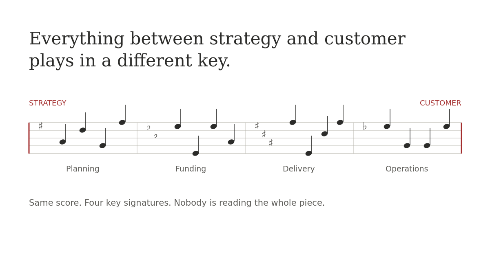

# Everything between strategy and customer plays in a different key.

Walk into most large organizations, and you won’t find a shortage of frameworks. You’ll find TOGAF governing the architecture practice. SAFe or Scrum running delivery. OKRs cascading down from the executive team. Jobs To Be Done shaping discovery. NPS and CSAT reporting back on how customers feel. Service blueprints on someone’s wall. Value stream maps in a deck from two years ago.

Every one of those is a good instrument. The problem is that none of them was scored to be played with the others.

Strategic intent gets defined at the top in the language of objectives. Execution gets organized by department, because that’s how the org chart works. Customer value gets measured at the end, in a survey, long after the decisions that determined it were made. And the signal that comes back from the customer — the only signal that tells you whether the strategy was right — has no defined path back up to the people who set it.

That’s the gap the **Insheights Integrated Value Creation System (IIVCS)** was built to close.

## Integration, not replacement

The word that does the most work in the name is *integrated*.

IIVCS is not a proposal to rip out your existing practices. It’s a system for making them cohere — purposefully unified across strategy, operating model, and value delivery, with value creation as the single purpose the whole thing serves.

It has three frameworks:

**OSM — Organization Strategy Model.** How strategic intent becomes prioritized value creation outcomes. OSM connects values, mission, and vision through a Strategic Value Creation process informed by internal and external context, leadership direction, stakeholder expectations, and enterprise risk. It scales vertically: Organization, then Enterprise and Function, then Portfolio. And it treats strategies as living hypotheses rather than annual artifacts.

**PTS — Product Transformation System.** How the organization structures itself to deliver. PTS defines four Product Operating Model enablers — Leadership, Practices and Behaviors, Organizational Architecture, Culture and Relationships — that empower persistent cross-functional teams working through continuous, overlapping phases: Discover, Define, Develop, Deliver, Launch, Support.

**CVDM — Customer Value Delivery Model.** How value actually reaches the customer. CVDM ensures every step in the customer journey triggers the right value stream stage, defining the products, capabilities, processes, and information flows required to turn a value proposition into a realized outcome.

## Value streams are the spine

The three frameworks are held together by something the organization already has: its value streams. The pre-existing workflows and capabilities through which value is created and delivered.

OSM governs them. PTS operationalizes them. CVDM realizes value through them.

That’s the sentence worth carrying out of this post. It’s also why IIVCS doesn’t require an organization to reorganize before it can start. The spine is already in the building.

## Product Mindset as the operating philosophy

A system of boxes and arrows will not change behavior. Product Mindset animates IIVCS — customer obsession, outcome over output, continuous discovery, hypothesis-driven thinking, cross-functional ownership.

What makes it more than a poster is that each principle has a specific home in each framework. In OSM, customer obsession means stakeholder expectations directly shape strategy. In PTS, it means teams are organized around value streams rather than functions. In CVDM, it means the customer journey anchors daily work. The repo explicitly maps all five principles across all three frameworks.

## Feedback runs upstream

Most operating models push work downhill and call the loop closed when something ships.

In IIVCS, the important direction is the other one. CVDM to PTS to OSM. Customer signal becomes delivery learning. Delivery learning becomes strategic evolution. Strategy gets refined continuously by what execution actually discovers, rather than at the next planning cycle.

## And it’s measured

This is where most integrated frameworks quietly stop. IIVCS carries a full measurement architecture:

- **3E** — Efficiency, Experience, Effectiveness, sequenced as Use → Feel → Achieve. The system's measurement language, applied consistently across every architecture element.
- **AER** — Adoption, Engagement, Retention. The behavioral signal layer, running two parallel tracks: how customers respond to value delivery, and how teams respond to the operating model.
- **8 Values** — Customer, Financial, People, Operational, Market, Strategic, Innovation, Impact. What the organization actually generates, with a bridge to the IR 6 Capitals for external reporting.

## The system is public

The full IIVCS is published as a GitHub repository. Not a landing page with a gated PDF behind it. The actual documents:

- The core framework definitions for OSM, PTS, and CVDM, with diagrams
- Framework Positioning — the canonical reference for how the three relate
- The 3E, AER, and 8 Values measurement models, plus practitioner guides
- The IIVCS Feedback System
- Comparisons against TOGAF, BIZBOK, ArchiMate, SAFe, Service Blueprint, Value Stream Mapping, JTBD, ISO 9241–11, Balanced Scorecard, Google HEART, AARRR, ADKAR, Kotter, McKinsey 7-S, IIRC 6 Capitals, EFQM, ESG/GRI, and OKRs
- Integration guidance for SAFe, Scrum, OKRs, ITIL, ERM, Design Thinking, VSM, and JTBD
- A glossary and a roadmap

**Read it here:** [**github.com/Insheights/in-frameworks**](https://github.com/Insheights/in-frameworks)
