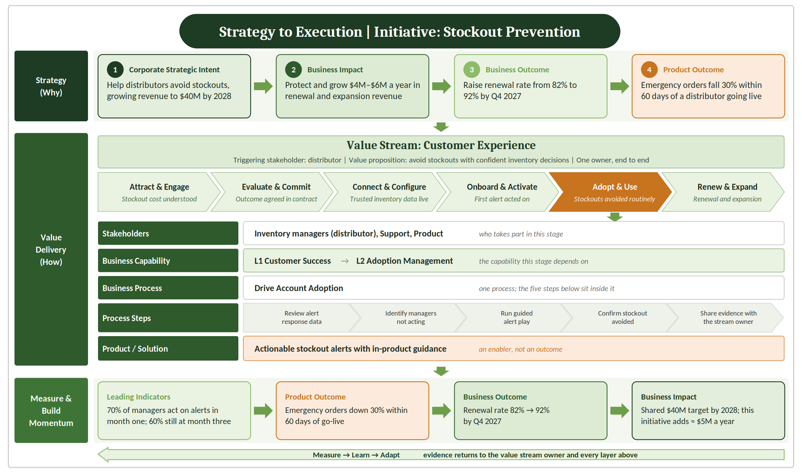

# Managing the Flow of Value from Strategy to Customer as One Continuous Stream, Owned End to End

Ask any organization who owns sales, engineering, or support, and you'll get a name in seconds. Ask who owns the outcome a strategy was meant to produce, and you'll usually get a pause, a committee, or several names at once.

That pause explains a familiar pattern. A strategy is approved, every team delivers its part, and a year later the outcome still falls short. Nobody failed at their job. Value leaked between jobs: customer feedback never reached the people setting direction, products shipped but weren't adopted, work stalled between teams, and intent turned into a list of deliverables along the way.

These leaks don't come from people. They come from an operating model organized around functions. That model works well inside each function, and nobody owns the spaces between them.

If the leaks live between functions, better functions won't close them. Something has to own the spaces.

## What a value stream is

In business architecture practice, a value stream is the end-to-end set of value-adding stages that creates an overall result for a stakeholder. It starts with a triggering stakeholder, the customer or other party whose need sets it in motion. Each stage adds an increment of value for that stakeholder, called a value item, and the value items build on one another until the stream delivers its value proposition.

A value stream isn't a department, and it isn't a process. A department is defined by the work it does, and a process describes how internal work gets done. A value stream is defined by the value a stakeholder receives, and it draws on every capability that value depends on.

A value stream also outlasts the initiatives that run through it. Initiatives come and go. The stream is the stable path they travel.

The Insheights Integrated Value Creation System (IIVCS) adds two things to that definition. First, a return path: evidence of what the stakeholder actually experienced travels back along the stream, so it can change what happens next. The second is an owner. A stream that nobody owns can be mapped perfectly and still leak value at every handoff.

The difference sounds small. In practice, it changes the question every team asks. In a function-based model, the question is “Did we do our part?” In a value stream, the question is “Did the value reach the customer, and what’s stopping it?”

## Stocklight, before

Stocklight, an illustrative company we’ve followed through this series, sells inventory visibility software to regional industrial distributors. Its strategy is to grow revenue from distributors to $40M by 2028, and leadership agreed on a clear intent: help distributors avoid stockouts.

Twelve months later, the forecasting module had shipped on time. Onboarding a new distributor still took about 90 days. Few inventory managers used the forecasts. Renewals kept slipping. And every team had hit its targets.

The reason was in how the intent was divided. Product owned the forecasting module and was measured on on-time release. Sales owned positioning and was measured on bookings. Installation owned connecting distributors and was measured on installations completed. Support owned training and help and was measured on ticket resolution time.

Each piece had an owner. The outcome had none. Value leaked in four places:

→ **Feedback:** what customers reveal never reaches the people setting strategy   
→ **Adoption, engagement, and retention:** customers and employees get access, not value   
→ **Fragmentation and handoffs:** every team owns a piece, and work waits between them   
→ **Translation:** intent becomes deliverables that are misaligned or incomplete

When renewals slipped, every function could show its own part had succeeded, and leadership saw the miss at the next quarterly review, long after the decisions that caused it.

## Stocklight, after

Stocklight starts managing its Customer Experience value stream as one stream: the full path a distributor takes as its customer. The stream triggers when a distributor faces costly stockouts, and its value proposition is to avoid stockouts through confident inventory decisions. It runs through six value stages, each ending in a value item:

- **Attract & Engage**, ending when the cost of the distributor’s stockouts is understood
- **Evaluate & Commit**, ending when the outcome is agreed in the contract
- **Connect & Configure**, ending when trusted inventory data is live
- **Onboard & Activate**, ending when the first alert is acted on
- **Adopt & Use**, ending when stockouts are avoided routinely
- **Renew & Expand**, ending in renewal and expansion

One leader owns the stream end to end. Stockout prevention becomes an initiative that runs through it, with a chain of targets that connects the boardroom to the warehouse floor. The $40M strategy depends on protecting and growing $4M to $6M a year in renewal and expansion revenue. That depends on raising the renewal rate from 82% to 92% by Q4 2027. And that depends on a product outcome distributors can feel: emergency orders falling 30% within 60 days of going live.

*Strategy sets the why, the value stream delivers the how, and measurement carries evidence back up to every layer.*

The initiative focuses on Adopt & Use, the stage where the product outcome is realized and where the most value leaks. Inventory managers at the distributor take part, supported by Stocklight’s support and product teams. It depends on Stocklight’s customer success capability, specifically adoption management, and runs through one process: driving account adoption. The alerts themselves are the solution, an enabler of the outcome, not the outcome.

People from product, sales, installation, and support all work in the stream. They still belong to their capabilities, which remain their home for expertise and standards. But they share the stream's measures: emergency orders falling, inventory managers acting on alerts, and distributors renewing.

Here’s how the stream closes each leak.

## Feedback

*The leak: what customers reveal never reaches the people setting strategy.*

In a value stream, evidence goes to the person who owns the outcome and can change the plan. At Stocklight, it’s built into the work: the last step in driving account adoption is sharing evidence with the stream owner, and what the measures show returns to every layer above, from the process to the strategy.

When support hears inventory managers asking for alerts rather than forecasts, it reaches the stream owner within days, not averaged into a quarterly satisfaction score. The owner shifts the next release toward alerts that tell managers when to act, because the plan is theirs to change.

**Value delivered:** what Stocklight delivers keeps pace with what distributors need now, not what the strategy assumed a year ago.

## Adoption, engagement, and retention

*The leak: customers and employees get access, not value.*

A value stream isn’t done when something ships. Adopt & Use only ends when its value item exists: stockouts avoided routinely. That makes adoption, engagement, and retention the stream’s measures, for employees adopting new ways of working as much as for customers.

Stocklight tracks two leading indicators for renewals: 70% of inventory managers acting on alerts in their first month, and 60% still acting in their third. Those numbers move before emergency orders fall, and long before renewals do, so the owner knows within weeks whether the initiative is working. When sales reps drift back to their old pitch, that’s the stream’s problem to solve, not another team's training ticket.

**Value delivered:** distributors get the outcome they bought, not just access to the software.

## Fragmentation and handoffs

*The leak: every team owns a piece, and work waits between them.*

A value stream replaces separate pieces, judged separately, with one owner and one shared measure. Every stage involves several stakeholders, so the owner sees and manages the handoffs between them, and the context behind the work travels with it.

Stocklight’s 90-day onboarding spans two stages: Connect & Configure and Onboard & Activate. Mapped as one stream, most of those 90 days turn out to be time spent waiting in queues. The value item at the end, the first alert acted on, gives the owner a single measure of time to first value, and a target of 30 days. Installation and support now plan together from the day a contract is signed. The salesperson’s notes on why a distributor bought, usually to avoid a painful seasonal stockout, move with the account, so no one serving that distributor has to rediscover the reason.

**Value delivered:** distributors reach their first avoided stockout sooner, and the people serving them understand what they’re trying to achieve.

## Translation

*The leak: intent becomes misaligned or incomplete deliverables.*

A value stream states its intent once as a chain of outcomes, and every capability works toward that chain instead of its own version. Deliverables are judged by what they contribute, not by whether they were completed.

At Stocklight, the forecasting module is no longer the goal. Emergency orders falling 30% is. Each layer explains the one below it: renewals rise because emergency orders fall, and emergency orders fall because inventory managers act on alerts. People question work that won’t move those numbers before it’s built, and they add missing work, like alerts, even though no one’s original plan included it.

**Value delivered:** what reaches distributors is what the strategy actually intended.

Each fix depends on two things: one owner for the whole path, and measures that count value only when the customer experiences it.

## Ownership isn’t a new idea

Toyota has worked this way for decades. Its chief engineer has total responsibility for developing a product line, leading a small, dedicated team that creates the product concept, builds the business case, leads the technical design, coordinates with production engineering and sales, and takes the product into production. ([Lean Enterprise Institute](https://www.lean.org/lexicon-terms/chief-engineer/))

What’s instructive is what the role doesn’t do. Most people on the team still report to managers in their own functional units, and the tension between the product leader and the functions becomes a source of innovation. End-to-end ownership didn’t require dismantling the functions. It required someone to own the whole.

Amazon reached a similar answer in its own language. When it started its digital media business, it made its first decision: appoint an owner, a “single-threaded leader,” Amazon’s term for a leader who owns one major initiative and can focus on it relentlessly, free to drive the business without being held back by the rest of the company. (Colin Bryar and Bill Carr, *Working Backwards*, 2021)

Different industries, different eras, same principle: an outcome needs an owner, and the owner needs a whole path to own it.

## What ownership requires

Naming an owner is easy. Ownership only works when it comes with authority across boundaries. An owner who can’t change priorities in the capabilities their outcome depends on has accountability without leverage. Often the function that feels the pain of a broken stream has the least authority to fix it, and that imbalance is exactly what ownership is meant to remove.

Ownership also changes how we handle failure. When one person owns an outcome, a miss becomes visible early, while it’s still a decision rather than a post-mortem. It’s much harder to call a failure an execution problem when the strategy and the execution have the same owner.

## Defining your stream

State a value stream as clearly as a strategy. Here’s Stocklight’s:

> *The **Customer Experience** value stream turns our intent to **help distributors avoid stockouts** into **fewer stockouts and confident inventory decisions** for **regional industrial distributors**, owned by **one accountable leader**, with **product, sales, installation, and support** contributing, measured by **emergency orders falling 30% within 60 days of go-live and renewal rate rising from 82% to 92% by Q4 2027**, and if **fewer than 70% of inventory managers act on our alerts in their first month**, **the stream owner** decides whether to persist, retune, re-resource, or stop.*

**Template 4: the value stream statement.** And the template:

> *The **[name]** value stream turns our intent to **[strategic intent]** into **[outcome]** for **[customers or stakeholders]**, owned by **[one accountable leader]**, with **[contributing capabilities]** contributing, measured by **[outcome measure and time frame]**, and if **[signal that we’re wrong, and by when]**, **[who decides]** decides whether to persist, retune, re-resource, or stop.*

The last clause is the stream’s rejection condition: the signal, named in advance, that the approach is wrong, and who decides what happens next.

If you can’t name one owner, you’ve found your first problem.

In IIVCS, value streams are the spine that all three frameworks run on. The [glossary](https://github.com/Insheights/in-frameworks/blob/master/glossary.md) defines the value stream and its stages.

## Find your stream

Pick one outcome that matters to your organization this year, and ask:

Who would answer for it if it failed? One person, or a meeting?

Can you name the stages it passes through, and the value each one produces?

Which measures do the contributing teams report? Is the outcome itself one of them, with a number and a date?

How long does work take from intent to outcome, and how much of that time is waiting?

When a customer reveals something important, how many days does it take to reach someone who can change the plan?

If the answers are “a meeting,” “no,” “no,” “mostly waiting,” and “we don’t know,” you have functions, not a stream.

## What comes next

The next article looks at why most strategies can’t be executed as written, and what it takes to write one that can.

The frameworks behind this series are open on GitHub: [github.com/Insheights/in-frameworks](https://github.com/Insheights/in-frameworks)

**Where does your organization stand?** The [Quick Self-Assessment](https://github.com/Insheights/in-frameworks/blob/master/quick-assessment.md) gives a directional reading in a few minutes: eight questions on how well strategy, teams, delivery and measurement work together.

*Who owns the outcome of your most important initiative, and could they change the plan tomorrow?*
