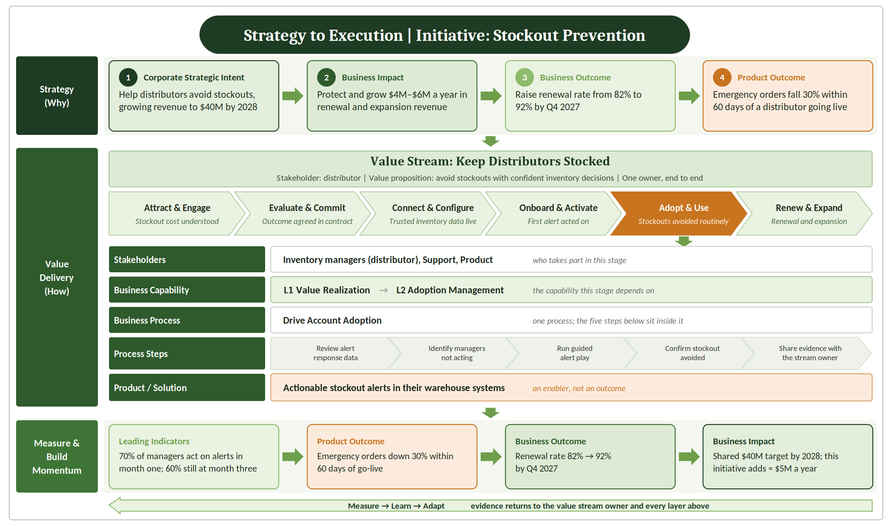

# Why Most Strategies Can’t Be Executed as Written, and What It Takes to Write One That Can

*The strategy band at the top is what this article rewrites; everything below it is how that strategy is delivered and measured.*

Most strategy documents are approved with confidence and executed in confusion. Leadership signs off on a vision, priorities, and a revenue target. Teams go away and start work. Six months later, everyone is busy, the priorities have quietly multiplied, and nobody can say whether the strategy is working.

The usual explanation is poor execution. Teams didn’t follow through, managers didn’t cascade it, and people resisted change. Sometimes that’s true. More often, the document was never something anyone could execute. It described where leadership hoped to end up, but not what problem it was solving, what it was choosing not to do, or how anyone would know it was wrong.

In the last article, we saw that value leaks between functions when nobody owns the path from intent to outcome. A value stream closes those leaks, but only if it starts with an intent it can own. Many strategies don’t provide one. They arrive as lists of projects, aspirations without outcomes, or bets nobody named.

You can’t execute a strategy you don’t own. The fix starts with how you write it.

## What “executable as written” means

An executable strategy is not a detailed plan. Detailed plans break on first contact with customers, competitors, and the people doing the work. A strategy that tries to specify every step becomes a project schedule, and it goes stale the week it’s published.

An executable strategy is one that people can act on without coming back to ask what it meant. It states the problem clearly enough that teams recognize it in their own work. It states the outcome precisely enough that they can tell whether they’re moving toward it. And it states the boundaries plainly enough that they know which good ideas to decline.

Put simply, a strategy is executable when it tells people what to decide, not just what to hope for. The test is practical: could a team lead, reading only the strategy, make the same trade-off leadership would have made? If the answer depends on who’s in the room, the strategy isn’t written yet.

## Stocklight, before

Stocklight, the illustrative company we’ve followed through this series, sells inventory visibility software to regional industrial distributors. In the last article, it organized around one value stream, Customer Experience, owned end to end. But go back to the strategy document that started the year, and the problem begins earlier.

The document read like most strategy documents do:

> ***Vision:*** *Become the leading inventory intelligence platform for regional distributors.*

> ***Priorities for the year:***

> - Launch the forecasting module by Q3

> - Expand into two new regions

> - Improve customer satisfaction

> - Modernize the data platform

> - Grow revenue to $40M by 2028

Nothing in it is wrong. Every item is reasonable, and the leadership team agreed to it all. That’s the problem. It was easy to agree to because it asked nobody to give anything up.

Read it as a team lead would, and it breaks in five places:

→ **No diagnosis:** it never says what is stopping distributors from avoiding stockouts today, so every team fills in its own answer

→ **Outputs instead of outcomes:** the forecasting module is a deliverable; nothing says what inventory managers should do differently once it ships

→ **No choices:** five priorities, no ranking, and nothing the company will stop or defer

→ **Hidden bets:** the strategy assumes distributors want forecasts, but never says so, so nobody tests it

→ **No owner:** each priority lands in a function, and none lands in the stream that could deliver it

The vision line hides a sixth issue. “Leading” can’t be measured, so it can’t be wrong, and a goal that can’t be wrong can’t steer anything.

Each of these gaps feeds a leak from the last article. A missing diagnosis becomes a translation leak. Outputs instead of outcomes become an adoption leak. No choices become a fragmentation leak. Hidden bets mean feedback has nothing to test. Execution didn’t fail at Stocklight. It inherited the gaps.

## What it takes: five things an executable strategy contains

Each gap has a matching fix. Here’s what each one asks of the writer, and how Stocklight’s strategy reads once it’s rewritten.

## 1. A diagnosis

*The gap: nobody says what the problem is.*

A strategy starts by naming what is actually in the way, in terms the customer would recognize. Without it, teams can’t judge whether their work addresses the problem or just sits near it.

Stocklight’s rewrite: *Distributors don’t lack inventory data. They act on it too late. Forecasts arrive as reports that inventory managers read after they've already made the reorder decision, and onboarding takes about 90 days, so many distributors reach their first renewal conversation before they’ve seen any value.*

That one paragraph changes the work. A forecasting module that produces better reports doesn’t touch the problem. Alerts at the moment of decision, and faster onboarding, do.

## 2. An outcome chain with numbers and dates

*The gap: deliverables stand in for results.*

An outcome is a change in what someone does or experiences. A strategy is executable when its outcomes connect, so each team can see how its result feeds the next one up, all the way to the business result.

Stocklight’s rewrite links four outcomes:

1. Onboarding time falls from 90 days to 30 by Q4 2027
2. At least 70% of inventory managers act on an alert in their first month
3. Emergency orders fall 30% within 60 days of go-live
4. Renewal rate rises from 82% to 92% by Q4 2027, supporting the $40M revenue target by 2028

The forecasting module still gets built. But it’s now judged by whether it moves the second and third lines, not by whether it ships in Q3.

## 3. Choices, including what you won’t do

*The gap: everything is a priority.*

A choice only counts if a reasonable person could have chosen otherwise. “Improve customer satisfaction” isn’t a choice, because nobody would choose the opposite.

Stocklight’s rewrite: *We will deliver alerts inside the warehouse systems inventory managers already run, rather than building a new dashboard. We will defer expansion beyond our current regions until the renewal rate reaches 88%. We will move the data platform work forward only where onboarding depends on it.*

Two of the original five priorities are now explicitly deferred or narrowed. That’s the point. A team lead who’s asked to support a new-region launch now knows the answer, and why.

## 4. Bets, named as bets

*The gap: assumptions are hidden, so nobody tests them.*

Every strategy rests on beliefs that might be wrong. Writing them down turns them from risks into things a team can test, and gives feedback somewhere to land.

Stocklight’s rewrite: *We are betting that inventory managers will act on alerts if they arrive in the warehouse systems they already run. We’ll test this with 10 distributors in Q1 2027. If fewer than 70% of their inventory managers act on our alerts in their first month, the stream owner decides whether to persist, retune, re-resource, or stop before scaling it.*

That last sentence is the bet’s rejection condition, and it matters as much as the bet. It tells the stream owner in advance what evidence should change the plan, so changing it is part of the strategy rather than a retreat.

## 5. An owner and a stream

*The gap: priorities land in functions, and the outcome lands nowhere.*

Each strategic intent needs one accountable owner and a value stream it travels through. If you can’t assign an intent to a stream, it’s either too vague to own, or it’s really several intents bundled together.

Stocklight’s rewrite: *The Customer Experience value stream owns this intent. Its owner is accountable for the outcome chain above, with product, sales, installation, and support contributing.*

This is where the strategy meets the anchor diagram from the last article: the intent sits at the top, travels through the stream’s stages, and is realized at Adopt & Use, when an inventory manager acts on an alert.

## The whole strategy, rewritten

Put together, Stocklight’s strategy is four statements. It starts with the strategy itself, stated as a bet with its diagnosis and choices, then how it will work, who owns the path, and finally what customers get:

> ***Strategy:*** *Regional industrial distributors can’t avoid stockouts today because their inventory managers see demand changes too late to act, and onboarding takes 90 days. By 2028, we will grow revenue from distributors to $40M by serving regional industrial distributors in North America through direct and partner channels with real-time inventory visibility, delivering alerts inside the warehouse systems they already run rather than building a new dashboard, and deferring expansion beyond our current regions until the renewal rate reaches 88%. We’re betting that connecting to the warehouse systems they already run, with nothing to replace, is an advantage competitors can’t easily match, and that inventory managers will act on alerts there. We’ll test it with 10 distributors in Q1 2027, and if fewer than 70% of inventory managers act on our alerts in their first month, the stream owner decides whether to persist, retune, re-resource, or stop.*

> ***Transformation:*** *By Q4 2027, we will move from onboarding customers through separate sales, installation, and support teams to onboarding each distributor through a single customer success team, so that distributors can go from signed contract to live inventory data without being passed between departments, measured by onboarding time falling from 90 days to 30.*

> ***Value stream:*** *The Customer Experience value stream turns our intent to help distributors avoid stockouts into fewer stockouts and confident inventory decisions for regional industrial distributors, owned by one accountable leader, with product, sales, installation, and support contributing, measured by emergency orders falling 30% within 60 days of go-live and renewal rate rising from 82% to 92% by Q4 2027, and if fewer than 70% of inventory managers act on our alerts in their first month, the stream owner decides whether to persist, retune, re-resource, or stop.*

> ***Value delivery:*** *Distributor inventory managers will reduce stockouts using real-time inventory visibility within 60 days of going live, and we will know because emergency orders at their warehouses fall.*

The strategy states the value proposition; value delivery is where it’s realized. Everything above the last line exists to make that line true.

It’s harder to agree to than the original, because it asks people to give things up. That difficulty is the sign it can be executed.

## What the evidence says

None of this is new. Strategy researchers and practitioners have pointed to the same gaps for years, from different directions.

**Most managers can’t name the strategy.** Donald Sull, Rebecca Homkes, and Charles Sull surveyed managers across hundreds of companies for their 2015 Harvard Business Review article, “Why Strategy Execution Unravels, and What to Do About It.” Given five tries, only around half of managers could list even one of their company’s top priorities, and only about a third could list the top three ([London Business School](https://www.london.edu/news/two-thirds-of-senior-managers-cant-name-their-firms-top-priorities)). The same research warned against treating execution as sticking to a fixed plan. That isn’t a communication failure. When a strategy has many priorities and no ranking, nothing is memorable enough to repeat.

**Goals are not strategy.** In *Good Strategy/Bad Strategy* (2011), Richard Rumelt describes the core of a good strategy as diagnosing the challenge, setting a guiding policy to address it, and taking coherent actions to carry out that policy. He names the signs of bad strategy: fluff, failing to face the challenge, mistaking goals for strategy, and objectives that are just a to-do list. Stocklight’s original document shows several of them. “Become the leading platform” is a goal. Five unranked priorities are a to-do list.

**More detail makes it worse.** In *The Art of Action* (2011), Stephen Bungay traces how military organizations learned to act under uncertainty. He describes three gaps between plans, actions, and outcomes: a knowledge gap (what we’d like to know versus what we know), an alignment gap (what we want people to do versus what they do), and an effects gap (what we expect our actions to achieve versus what they achieve). The instinctive response is more detail, more instructions, and more control, and each one widens the gap it targets. The military's answer was to state intent clearly — what to achieve and why — and leave people room to decide how. That’s what an executable strategy does: it’s precise about the outcome and the boundaries, and deliberately light on the steps.

Taken together, the lesson is consistent. Strategies fail in execution because they're written to be approved, not acted on.

## Writing your own

Earlier in the series, we treated strategy as a set of bets. The templates below make that literal. You can write it two ways, depending on how you’re building the strategy.

**Template 5: the strategy as a bet.** This extends template 1 from earlier in the series. It keeps where you’ll play and how you’ll win, the choices A.G. Lafley and Roger Martin set out in *Playing to Win* (2013), and the objective, and adds the three elements most strategies leave out: the diagnosis, the trade-offs (what you’re declining and what you’re deferring), and the bet with its test. Use it with templates 2 to 4.

> ***[Target customers]** can’t **[achieve a specific result]** today because **[diagnosis]**. By **[time horizon]**, we will **[specific, measurable objective]** by serving **[target customers/segments]** in **[markets, geographies, channels]** with **[offering]**, choosing **[choice]** rather than **[alternative we’re declining]**, and deferring **[what we’re not doing yet]** until **[condition]**. We’re betting that **[source of advantage competitors can’t easily match]** will win, we’ll test it by **[test and date]**, and if **[signal that we’re wrong, and by when]**, **[who decides]** decides whether to persist, retune, re-resource, or stop.*

**Template 5a: the one-page strategy.** A shortcut that condenses the strategy, transformation, value stream, and value delivery statements into one, for when you need one page in front of a leadership team.

> ***[Target customers]** can’t **[achieve a specific result]** today because **[diagnosis]**. By **[time horizon]**, we will **[choice]** rather than **[alternative we’re declining]**, and move from **[how we work today]** to **[how we will work]**. We’ll know it’s working when **[evidence of the outcome]**, leading to **[specific, measurable objective]**. We will defer **[what we’re not doing yet]** until **[condition]**. We’re betting that **[key assumption]**, and if **[signal that we’re wrong, and by when]**, **[who decides]** decides whether to persist, retune, re-resource, or stop. **[One accountable leader]** owns it through the **[name]** value stream.*

Stocklight’s one-page version:

> *Regional industrial distributors can’t avoid stockouts today because their inventory managers see demand changes too late to act, and onboarding takes 90 days. By Q4 2027, we will deliver alerts inside the warehouse systems they already run rather than building a new dashboard, and move from onboarding through separate sales, installation, and support teams to onboarding each distributor through a single customer success team. We’ll know it’s working when onboarding falls from 90 days to 30 and emergency orders fall 30% within 60 days of go-live, leading to renewals rising from 82% to 92% by Q4 2027 and revenue from distributors reaching $40M by 2028. We will defer expansion beyond our current regions until the renewal rate reaches 88%. We’re betting inventory managers will act on alerts in the warehouse systems they already run, and if fewer than 70% act on our alerts in their first month, the stream owner decides whether to persist, retune, re-resource, or stop. One accountable leader owns it through the Customer Experience value stream.*

Whichever you use, if you can’t fill in the “rather than” or the “defer” blanks, you haven’t made a choice yet. In IIVCS, this is the work of the Organization Strategy Model (OSM). Its [practitioner guide](https://github.com/Insheights/in-frameworks/blob/master/guides/osm-practitioners-guide.md) covers the [One-Page Strategy](https://github.com/Insheights/in-frameworks/blob/master/guides/osm-practitioners-guide.md#step-2--make-the-strategic-choices) and the [Priority Register](https://github.com/Insheights/in-frameworks/blob/master/guides/osm-practitioners-guide.md#step-3--set-and-rank-strategic-value-priorities), where each bet is recorded with its rejection condition.

## Test your current strategy

Take your organization’s current strategy document and ask five questions:

1. Can you find a sentence that names the problem, in words a customer would recognize?
2. Can you restate each priority as a change in what someone does, with a number and a date?
3. What has the strategy explicitly chosen not to do, or to defer?
4. Which sentence is a bet, and what evidence would make you abandon it?
5. Who owns each intent, and which value stream does it travel through?

Then give the strategy to a team lead and ask them to make one real trade-off using only the page. If their answer matches leadership’s, the strategy is executable. If they come back with questions, those questions are the parts still to be written.

## What comes next

A strategy written this way gives a value stream something to own: a problem, an outcome chain, a set of choices, and bets with attached signals. The next article, From Strategic Intent to Outcomes an Empowered Team Can Own, shows how that intent becomes work a team can actually be accountable for.

The framework behind this series is open on GitHub: [github.com/Insheights/in-frameworks](https://github.com/Insheights/in-frameworks)

**Where does your organization stand?** The [Quick Self-Assessment](https://github.com/Insheights/in-frameworks/blob/master/quick-assessment.md) gives a directional reading in a few minutes: eight questions on how well strategy, teams, delivery and measurement work together.

*If you handed your strategy to a team lead tomorrow, what would they decide differently because of it?*
