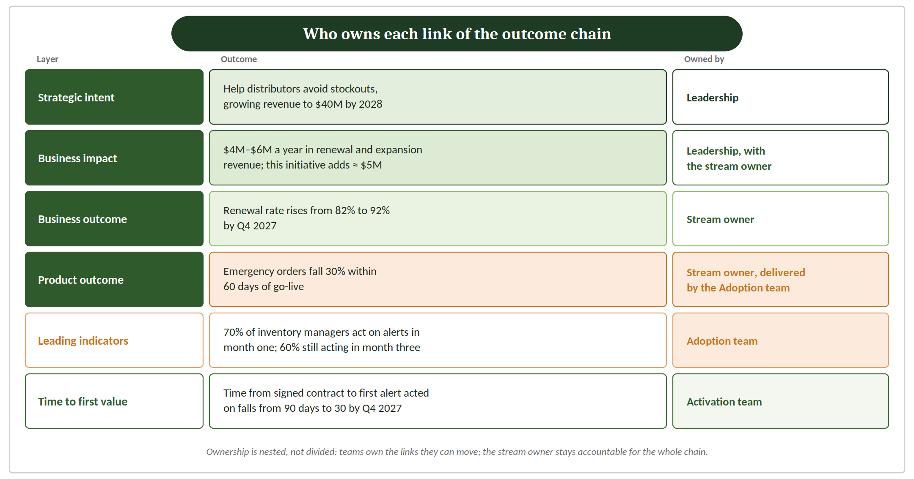
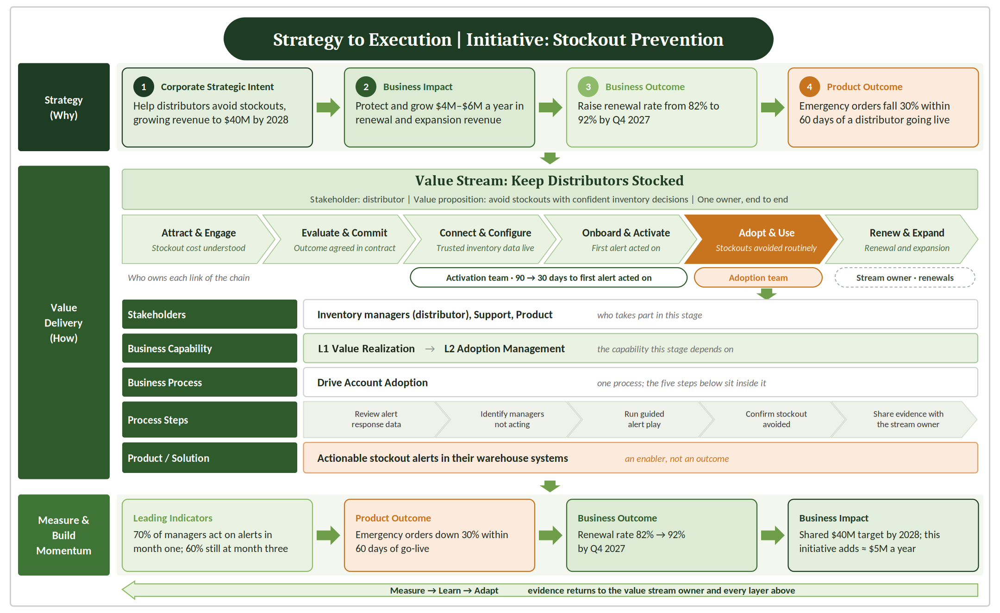

# From Strategic Intent to Outcomes an Empowered Team Can Own

Most organizations say they want teams to own outcomes. Then they hand those teams a list of projects with dates attached. The strategy talks about renewals and customer results. The team’s quarter is measured on whether the release shipped.

It isn’t hypocrisy. Somewhere between the strategy page and the team’s backlog, the intent has to be translated, and the translation usually defaults to what’s easiest to assign and check: work. Outcomes are hard to divide. Projects divide cleanly.

In the last article, Stocklight rewrote its strategy so a value stream could own it: a diagnosis, an outcome chain with numbers and dates, choices about what not to do, and bets with signals attached. That gives the stream owner something real to be accountable for. But a stream owner doesn’t do the work. Teams do. And “raise the renewal rate from 82% to 92% by Q4 2027” is not something a team can own on a Monday morning. It’s too far from their work, too slow to move, and depends on too many other people.

So the question this article answers is the one that comes next: how does an intent a stream can own become work a team can be accountable for, without collapsing back into a project list?

## What an empowered team can actually own

Ownership isn’t a label you assign. An empowered team can expect five things before it’s asked to own an outcome, and when one is missing, accountability turns into blame:

→ **Influence:** the team can move the number with its own work, without waiting on another team’s release

→ **Visibility:** the team can see the number move within its own planning cycle, in weeks rather than quarters

→ **Line of sight:** the team can trace how its outcome feeds the stream’s outcome, and the stream’s outcome feeds the strategy

→ **Boundaries:** the team knows which good ideas it must decline, because the strategy’s choices and deferrals travel with the outcome

→ **Authority:** the team can change its solution without asking permission, and knows exactly when it must ask

A renewal rate fails the first two expectations for almost any single team. A feature fails the third: shipping it says nothing about whether it mattered. What passes all five is usually something in between: a change in what a stakeholder does at one stage of the value stream, measured close enough to the work that the team can learn from it.

That’s the core move. The strategy’s outcome chain isn’t divided by function or broken into projects. It’s divided by value stage, and each team takes the link of the chain it can actually move.

## Stocklight, before

Stocklight, the illustrative company we’ve followed through this series, sells inventory visibility software to regional industrial distributors. Its rewritten strategy was approved. The Customer Experience value stream had one accountable leader. Then came planning, and the old habits returned.

The stream owner’s first instinct was to break the strategy into work and hand it out:

> ***Product:*** *launch the forecasting module by Q3*

> ***Engineering:*** *build integrations with three warehouse systems*

> ***Installation:*** *cut average installation time by 20%*

> ***Support:*** *reduce onboarding tickets by 25%*

> ***Customer success:*** *run quarterly business reviews with every distributor*

Every item is sensible, and every one has a number. But read it against the five expectations, and it falls apart:

→ **Product** can ship the forecasting module on time while no inventory manager acts on a single forecast. It owns an output, not an outcome.

→ **Installation** and **support** each own half of onboarding. Neither owns the 90 days, so the waiting between them stays unowned.

→ **Engineering** can build three integrations nobody asked for, because nothing links its work to whether distributors reach first value faster.

→ **Nobody** carries the strategy’s choices. The decision to deliver alerts inside existing warehouse systems rather than build a new dashboard appears in none of the five assignments.

This is the strategy from the last article, rewritten well, and then translated back into the functional plan it replaced. The translation leak from earlier in the series hasn’t gone away. It moved one level down.

## Stocklight, after

The second time, the stream owner starts from what’s already written. Neither statement changes in this article.

The strategy, from the last article:

> *Distributors don’t lack inventory data; they act on it too late. By 2028, we’ll grow revenue to $40M by delivering alerts inside the warehouse systems they already run, rather than building a new dashboard, and we’ll defer new regions until renewals reach 88%. We’re betting inventory managers will act on alerts there. We’ll test it with 10 distributors in Q1 2027 and revisit if fewer than 70% act in their first month.*

The value stream, from the article before it:

> *The **Customer Experience** value stream turns our intent to **help distributors avoid stockouts** into **fewer stockouts and confident inventory decisions** for **regional industrial distributors**, owned by **one accountable leader**, with **product, sales, installation, and support** contributing, measured by **emergency orders falling 30% within 60 days of go-live and renewal rate rising from 82% to 92% by Q4 2027**, and we will revisit it if **fewer than 70% of inventory managers act on our alerts in their first month**.*

What’s new is only what happens below the stream owner. Instead of breaking these statements into functional assignments, the stream owner walks the outcome chain layer by layer and asks at each one: who could move this, and how fast would they know?

The top layers don’t change hands. Leadership owns the intent and the business impact it drives. The stream owner owns the business outcome and stays accountable for the product outcome, as the value stream statement says. What changes is the bottom of the chain. Instead of five functional assignments, two teams each take a link they can move and see moving within weeks, aligned to the value stages where that link is realized.

Ownership here is nested, not divided. A team owning a link doesn’t take it away from the stream owner, who stays accountable for the whole chain and decides when the two teams’ needs collide.

*The strategy and the stream stay the same. Each team takes the link of the chain it can move at the stages where that link is realized.*

## The Activation team

The Activation team is the single customer success team the transformation statement called for. Installation, support, and an engineer from product sit on it together. It spans two value stages, Connect & Configure and Onboard & Activate, because the 90 days span both, and most of that time is waiting between them.

It owns one outcome: time from signed contract to the first alert acted on, from 90 days to 30. It watches a leading indicator weekly: days until trusted inventory data is live for each new distributor. It decides how to sequence installation and training, which warehouse systems to connect first, and what to stop doing. The three integrations engineering was going to build become a question the team answers with data: which systems are new distributors actually running?

## The Adoption team

The Adoption team is a product team focused on Adopt & Use, the stage where the product outcome is realized and where the most value leaked earlier in the series. Inventory managers at distributors take part in its discovery work, alongside Stocklight’s support and product people.

It owns one outcome: emergency orders falling 30% within 60 days of go-live. Its leading indicators come from the strategy’s bet: at least 70% of inventory managers acting on an alert in their first month, and 60% still acting in their third. It decides alert thresholds, timing, wording, and where in the warehouse system an alert appears.

The forecasting module didn’t disappear. It stopped being an assignment and became an option. If the team’s evidence says forecasts help inventory managers act on alerts, it builds them. If not, it doesn’t, and nobody has to explain a missed Q3 date.

## What each team inherits

Both teams carry the strategy’s boundaries: alerts are delivered inside the warehouse systems distributors already run, not in a new dashboard; expansion beyond current regions waits until the renewal rate reaches 88%; data platform work moves forward only where onboarding depends on it. Both carry the bet and its revisit signal: if fewer than 70% of inventory managers act on alerts in their first month during the Q1 2027 test with 10 distributors, the Adoption team brings that evidence to the stream owner before anything scales.

## What accountability means once a team owns an outcome

Handing a team an outcome changes what it’s accountable for. It’s no longer accountable for the plan. It’s accountable for three things.

**The outcome.** The team commits to moving a number, not to delivering a scope. The plan is the team’s current best guess about how to move it, and the team is expected to change it as evidence arrives.

**The evidence.** The team is accountable for knowing, early and honestly, whether its work is moving the number. A team that misses its target but shows by week six that the bet was wrong has done its job. A team that hits every delivery date while the number stays flat has not.

**The escalation.** The team is accountable for raising its hand at the right moment: when the revisit signal fires, or when moving the outcome would mean crossing one of the strategy’s boundaries. An Adoption team that concludes distributors really do need a separate dashboard doesn’t build one quietly. It brings the evidence to the stream owner, because that choice belongs to the strategy.

The second point is the hardest. Earlier in the series, we saw how fear of failure keeps strategies from ever being labeled as failing; only execution fails. Team-level ownership only works if the same rule is reversed at every level. A bet disproved quickly is a result. If teams are punished for bad news, they’ll go back to owning outputs, because outputs are always safe to report.

## What the evidence says

Practitioners from product management, software delivery, and military command have reached the same conclusion from different directions.

**Give teams problems, not features.** In *Escaping the Build Trap* (2018), Melissa Perri describes organizations that measure success by what they ship rather than by the value it creates, and stay busy without getting better. Marty Cagan makes the positive case in *Empowered* (2020): strong product teams are given problems to solve and held accountable for results, rather than handed a roadmap of features to deliver. The five expectations earlier in this article are what make that empowerment real rather than declared. Stocklight’s first plan was a build trap with good intentions. Its second gave each team a problem.

**Align teams to a stream, not a function.** In *Team Topologies* (2019), Matthew Skelton and Manuel Pais describe the stream-aligned team: a team aligned to a single flow of work, with the skills to deliver value in that flow without handing work off to other teams. They also argue that a team’s scope should fit what it can hold in mind at once. Both ideas explain why Stocklight’s teams map to value stages rather than to departments, and why each owns one outcome rather than five.

**Check the translation before the work starts.** In *The Art of Action* (2011), Stephen Bungay describes backbriefing: after receiving an intent, the people who will act on it brief back what they understood, what they plan to do, and what they need. Gaps in the translation surface before they become gaps in execution. Hoshin kanri, the strategy deployment practice associated with Toyota, uses a similar loop called catchball, in which targets are passed back and forth between levels until both sides agree they’re right and achievable. In both, teams negotiate the outcome they own, not just receive it.

*The common lesson: ownership is designed at the point of translation. If the translation produces tasks, teams will own tasks.*

## Writing your own

**Template 6: the team outcome brief.** This sits under the value stream statement from earlier in the series. Where the value stream statement names one accountable leader for the whole path, the team outcome brief names the link of the chain a team takes on, and the room it has to move it.

> *The **[team]** owns **[change in what a stakeholder does or experiences]** at the **[value stage]** stage of the **[name]** value stream, moving **[measure]** from **[baseline]** to **[target]** by **[date]**, which feeds **[the next outcome up the chain]**. We’ll know within **[weeks]** from **[leading indicator]**. We decide **[solution choices the team makes]**, within **[choices and deferrals inherited from the strategy]**, and we’ll bring evidence to **[stream owner]** if **[signal that we’re wrong, or a boundary we’d need to cross]**.*

Stocklight’s Adoption team:

> *The Adoption team owns inventory managers acting on alerts before stockouts happen at the Adopt & Use stage of the Customer Experience value stream, moving emergency orders down 30% within 60 days of go-live, which feeds the renewal rate rising from 82% to 92% by Q4 2027. We’ll know within four weeks from the share of inventory managers acting on an alert in their first month, with a target of 70%. We decide alert thresholds, timing, wording, and where alerts appear, within delivering alerts inside the warehouse systems distributors already run rather than a new dashboard, and we’ll bring evidence to the Customer Experience stream owner if fewer than 70% of inventory managers act on our alerts in their first month.*

Stocklight’s Activation team:

> *The Activation team owns distributors reaching first value at the Connect & Configure and Onboard & Activate stages of the Customer Experience value stream, moving time from signed contract to first alert acted on from 90 days to 30 by Q4 2027, which feeds emergency orders falling 30% within 60 days of go-live. We’ll know within two weeks of each signing from days until trusted inventory data is live. We decide how installation and training are sequenced and which warehouse systems to connect first, within moving data platform work forward only where onboarding depends on it, and we’ll bring evidence to the Customer Experience stream owner if more than one in five new distributors needs a custom integration.*

If you can’t fill in the “we decide” blank with something real, the team doesn’t own an outcome. It owns a task list with a number attached. All the templates, with Stocklight’s examples, are in the framework repo on GitHub.

## Test what your teams own

Pick one team working on your most important initiative and ask its lead to brief back, in their own words, without notes:

1. What outcome do you own, as a change in what someone does, with a number and a date?
2. How does it feed the outcome above yours, and the one above that?
3. How soon will you know if your work is moving it, and from what signal?
4. What could you change tomorrow without asking anyone?
5. What good idea would you decline, and why?
6. What evidence would make you go to the stream owner?

If the first answer is a deliverable, the team owns output. If the third answer is “at the quarterly review,” it can’t learn fast enough to own anything. If the fourth answer is “nothing,” it has accountability without authority. And if the brief-back doesn’t match what the stream owner would have said, that gap is still translation work.

## What comes next

A strategy a stream can own, divided into outcomes teams can own, gives every level something real to be accountable for. It also raises a harder question: when a number moves, how do you know real value was created? The next article, Efficient, Experience, Effective: The Three Tests of Real Value, looks at the three tests every outcome has to pass: whether stakeholders can use what’s delivered with less effort, whether they feel the difference, and whether they achieve what they came for.

The framework behind this series is open on GitHub: [github.com/Insheights/in-frameworks](https://github.com/Insheights/in-frameworks)

*Ask one of your teams what they own. Would they name an outcome, or a deliverable?*
