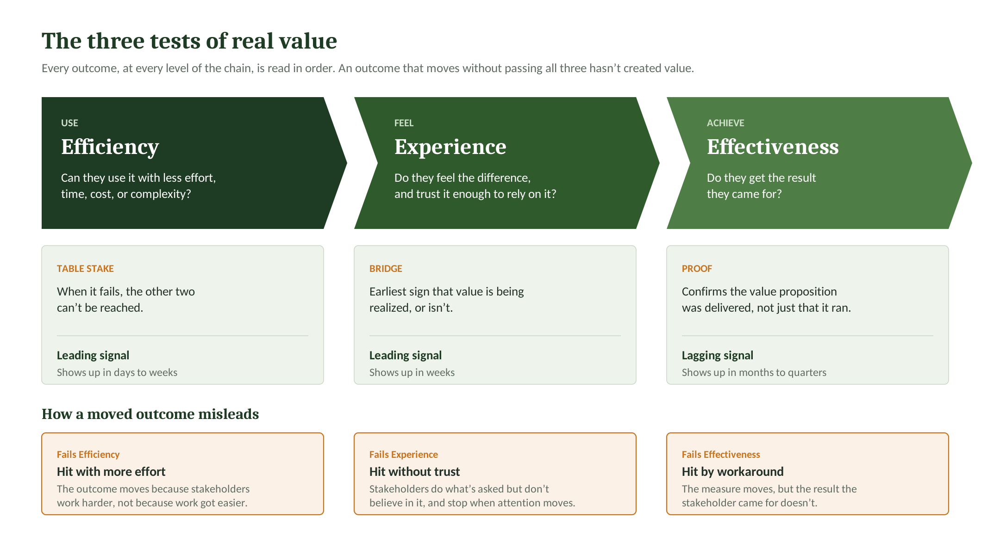
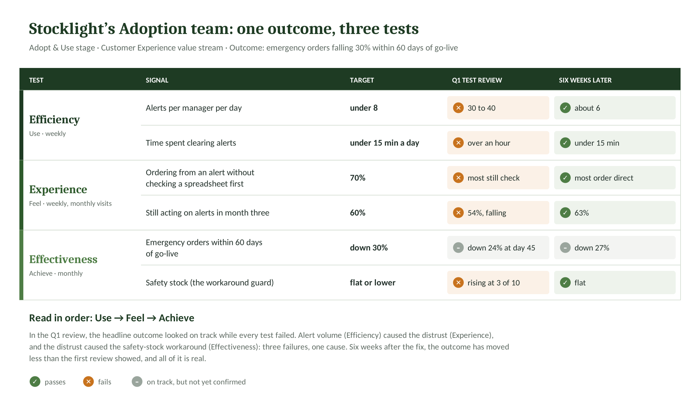

# Efficiency, Experience, Effectiveness: The Three Tests of Real Value

A support team cuts ticket volume by making the contact form harder to find. A sales team lifts its renewal rate with discounts that erase the margin. An onboarding team shortens time to go-live by skipping the training customers needed. Each team hit its outcome. None of them created the value the outcome was meant to stand for.

Usually it isn’t cheating. It’s what happens when a single measure stands in for a change in someone’s work. The measure is a proxy, and a team that’s working hard and learning fast will find the quickest way to move it. The quickest way isn’t always the one that creates value.

In the last article, Stocklight divided its outcome chain by value stage so that two teams could each own a link they could move and see moving within weeks. That solved the ownership problem and created a new one. The closer an outcome sits to the work, the easier it is to move, and the easier it is to move without delivering what the stakeholder came for.

So this article answers the question the last one left open: when an outcome moves, how do you know you created real value?

## Three tests, in order

Every outcome, at every level of the chain, has to pass three tests. Each asks something different about the stakeholder the value is for:

→ **Efficiency (Use):** can they use what’s delivered with less effort, time, cost, or complexity than before, not more?

→ **Experience (Feel):** do they feel the difference? Are they more confident, less anxious, and trusting enough to rely on it?

→ **Effectiveness (Achieve):** do they get the result they came for, the one the value proposition promised?

In the framework behind this series, these are the [Efficiency, Experience, Effectiveness (3E) model](https://github.com/Insheights/in-frameworks/blob/master/3e.md). What makes them useful is the order. 3E reads them as a sequence, not as parallel lenses to watch at once, because that’s the order in which a stakeholder usually meets value. They can’t feel value they can’t use, and they won’t stay long enough to achieve anything with value they don’t trust. The sequence is a reasoned model of where value tends to break down, not a proven causal law. Treat it as the order to look in, then confirm what you find with evidence.

Each test has its own role. Efficiency is the table stake: when it fails, you can’t reach the other two. Experience is the bridge: it’s the earliest signal that value is being realized, and the best early warning that achievement will or won’t follow. Effectiveness is the proof: it confirms that the value proposition was delivered, not merely that the system ran. The first two show up in days or weeks. The third confirms last.

The sequence also explains how a moved outcome can mislead. Each test catches a different way to hit an outcome without creating value:

→ **Hit with more effort.** The outcome moves because stakeholders are working harder, not because their work got easier. It fails Efficiency.

→ **Hit without trust.** Stakeholders do what’s asked but don’t believe in it, and stop as soon as attention moves elsewhere. It fails Experience.

→ **Hit by workaround.** The measure moves, but the result the stakeholder came for doesn’t. It fails Effectiveness.

None of these shows up in the outcome’s measure. All three show up in the stakeholder.

## Stocklight, before

Stocklight, the illustrative company we’ve followed through this series, sells inventory visibility software to regional industrial distributors. Its strategy bets that inventory managers will act on alerts delivered inside the warehouse systems they already run, and it set a test with 10 distributors in Q1 2027 to find out.

Three months into that test, the Customer Experience stream owner’s review looked good:

> ***The bet:*** *78% of inventory managers acted on an alert in their first month, against a rejection condition of fewer than 70%*

> ***Adoption team:*** *emergency orders down 24% at day 45, on track for 30% by day 60*

> ***Activation team:*** *time from signed contract to first alert acted on, down from 90 days to 41*

The bet held, and every outcome moved in the right direction. The stream owner was ready to scale beyond the test.

Then the Adoption team ran its monthly discovery visits, and the inventory managers told a different story. Read against the three tests, every headline outcome came apart:

→ **Efficiency.** “Acted on” counted any acknowledgment of an alert. Inventory managers got 30 to 40 alerts a day, most for slow-moving items that weren’t at real risk. A typical manager spent more than an hour a day clearing them, and two distributors had assigned a second person just to keep up. Stocklight promised less work and delivered more.

→ **Experience.** After a run of early false alarms, managers didn’t trust the thresholds, so most still checked their spreadsheet before placing an order. The share still acting on alerts in their third month was 54%, below the 60% target and falling. The value stream promised confident inventory decisions. Managers felt it was one more queue to watch.

→ **Effectiveness.** Emergency orders were falling, but at three of the ten distributors the drop came from raising safety stock after the false alarms, not from acting on alerts earlier. Those distributors had fewer stockouts and more cash tied up in inventory. The outcome moved, but the problem the strategy diagnosed, that distributors act on inventory data too late, hadn’t changed.

Every outcome passed. Every test failed. Had the stream owner scaled on that review, Stocklight would have rolled alert fatigue out to its whole customer base and found out when renewals came due, long after changing course was cheap.

## Stocklight, after

The second time, the Adoption team didn’t just report its outcome. It reported the outcome against all three tests, and read them in order.

It started with Efficiency, because nothing downstream can be trusted until Efficiency passes, and that’s where the cause was. Alert volume produced the distrust. The distrust produced the safety-stock workaround. Three failures, one cause.

The fix sat inside the team’s own authority. The team outcome brief from the last article said the Adoption team decides alert thresholds, timing, wording, and where alerts appear. So it set thresholds for each item from its lead time and demand variability, batched low-risk alerts into a single morning summary, and redefined “acting on an alert” as an order placed or adjusted within the item’s lead-time window, not a click. Then it measured each test with its own signal:

→ **Efficiency (Use):** alerts per manager per day, target under eight, and time spent on alerts, target under 15 minutes a day. Reviewed weekly.

→ **Experience (Feel):** the share of managers who order from an alert without checking their spreadsheet first, and the share still acting in their third month, target 60%. Reviewed weekly, with monthly discovery visits.

→ **Effectiveness (Achieve):** emergency orders falling 30% within 60 days of go-live, with safety stock flat or lower. Reviewed monthly.

The last clause matters most. “With safety stock flat or lower” closes the workaround. It turns an outcome that could be hit by overstocking into one that can only be hit by acting earlier.

Six weeks later, managers were getting about six alerts a day and clearing them in under 15 minutes. Most were ordering straight from the alert, and the share still acting in their third month had risen to 63%. Emergency orders were down 27% with safety stock flat. The headline outcome had moved less than the first review showed. All of it was now real.

The redefinition also reached the Activation team. Its time to first value went from 41 days to 52 overnight, because a first alert “acted on” now meant an order, not a click. Nothing about onboarding had changed. The measure had simply stopped flattering it, and the team now knew the real distance to its 30-day target.

The same tests apply at every link of the chain, not only at the team level. Revenue growth toward $40M that costs more to serve than it earns fails Efficiency. Renewals won with discounts from distributors who don’t trust the product fail Experience. The stream owner and leadership ask the same three questions about their outcomes as the teams do about theirs, but on a slower cadence.

## What the evidence says

Researchers in usability, customer loyalty, and measurement have each found part of this.

**Usability has been measured in threes for decades.** ISO 9241-11, the international standard for usability, first published in 1998 and revised in 2018, defines usability through effectiveness, efficiency, and satisfaction in a specified context of use. 3E borrows the structure and changes two things: it reads the three as a sequence rather than as parallel lenses, and it applies them to value stages and outcomes, not only to a person using a screen.

**Effort comes first.** In “Stop Trying to Delight Your Customers” (Harvard Business Review, 2010), Matthew Dixon, Karen Freeman, and Nicholas Toman reported research on customer service interactions showing that reducing customer effort drove loyalty more than exceeding expectations. That’s the case for Efficiency as the table stake. Stocklight couldn’t earn trust while it was adding an hour to every manager’s day.

**Feelings count, even in B2B.** Bain & Company’s Elements of Value research, published in Harvard Business Review in 2016 for consumers and in 2018 for business buyers, found that business purchases are shaped by personal and emotional elements, such as reduced anxiety, alongside functional and economic ones. “Confident inventory decisions” in Stocklight’s value stream statement is an emotional element. It needed its own measure.

**A target changes what it measures.** The economist Charles Goodhart observed in 1975 that a statistical relationship tends to break down once it’s used for control, an idea the anthropologist Marilyn Strathern later condensed into the familiar warning that a measure turned into a target stops being a good measure. The three tests are a practical defense. An outcome that moves while stakeholders’ effort rises, their trust falls, or their real result stays flat has been gamed, even if nobody meant to.

The common lesson: a moved outcome tells you something changed. The stakeholder tells you whether it was value.

## Writing your own

**Template 7: the 3E outcome profile.** This sits beside the team outcome brief from the last article. The brief names the outcome a team owns. The profile names the three tests that outcome has to pass.

> *For **[outcome]** at the **[value stage]** stage, **[stakeholder]** can use it if **[effort, time, or cost signal]** stays below **[threshold, a starting band set from your baseline]**; they feel it if **[trust or confidence signal]** reaches **[threshold, a starting band set from your baseline]**; and they achieve it if **[outcome measure]** moves from **[baseline]** to **[target]** by **[date]** without **[the workaround that would fake it]**. We read Use every **[cadence]**, Feel every **[cadence]**, and Achieve every **[cadence]**, in that order.*

Stocklight’s Adoption team:

> *For emergency orders falling 30% within 60 days of go-live at the Adopt & Use stage, inventory managers can use it if alerts stay below eight a day and take less than 15 minutes to clear; they feel it if 70% order from an alert without checking a spreadsheet first and 60% still act on alerts in their third month; and they achieve it if emergency orders fall 30% within 60 days of go-live without safety stock rising. We read Use weekly, Feel weekly with monthly discovery visits, and Achieve monthly, in that order.*

If you can’t fill in the “without” blank, you haven’t yet asked how your outcome could move without creating value. Someone on your team will eventually find out for you. In the Insheights Integrated Value Creation System (IIVCS), the [3E model](https://github.com/Insheights/in-frameworks/blob/master/3e.md) defines the three tests, and the [metrics and indicators guide](https://github.com/Insheights/in-frameworks/blob/master/metrics-and-indicators.md#part-5--thresholds-and-reference-bars) gives candidate signals for each and how to set their thresholds.

## Test your outcomes

Pick the outcome your team is proudest of moving this quarter and ask:

1. Did it take stakeholders less effort to get there, or more?
2. Would they say, unprompted, that they feel the difference?
3. Did they get what they came for, or did the outcome move some other way?
4. Which of the three can you see within weeks, and which only within quarters?
5. Reading the three in order, where does the first failure appear?

If you can’t answer the first, you’re tracking outcomes without seeing what they cost the people they’re for. If the second depends on a survey sent once a year, Experience will reach you after the churn. If the third is “the outcome moved,” you’ve confirmed the proxy, not the value.

## What comes next

Three tests tell you whether you delivered value. They don’t tell you what stakeholders do about it. The next article shifts from how you deliver value to what it produces in behavior: whether stakeholders adopt it, engage with it, and keep using it.

The framework behind this series is open on GitHub: [github.com/Insheights/in-frameworks](https://github.com/Insheights/in-frameworks)

**Where does your organization stand?** The [Quick Self-Assessment](https://github.com/Insheights/in-frameworks/blob/master/quick-assessment.md) gives a directional reading in a few minutes: eight questions on how well strategy, teams, delivery and measurement work together.

*Pick the outcome your team moved most this quarter. Would the people it was for say they feel the difference?*
