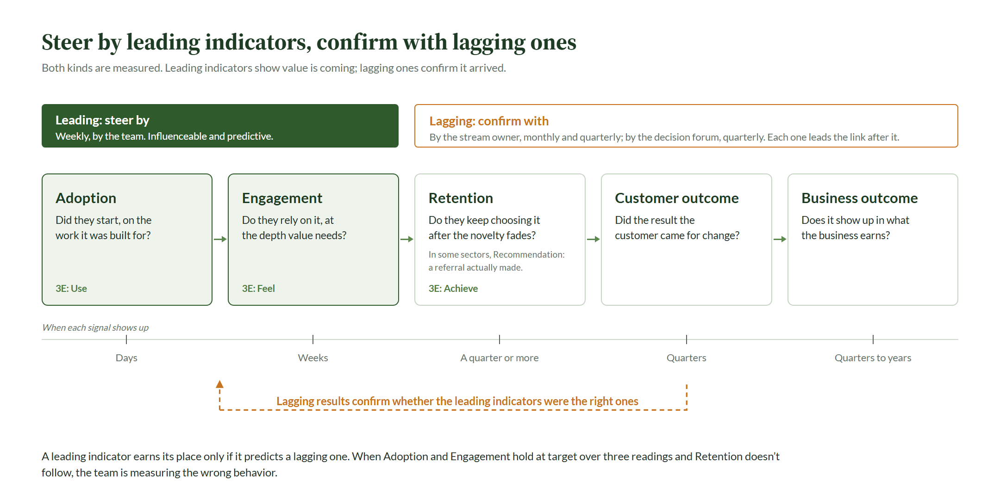
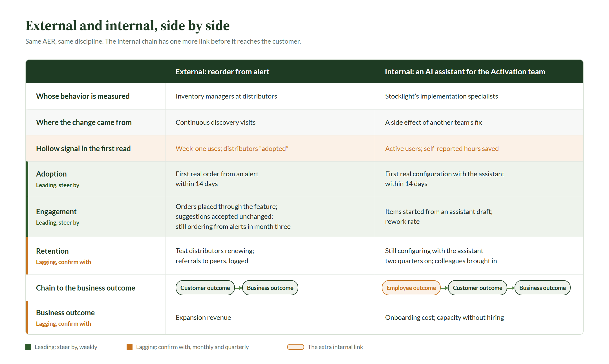
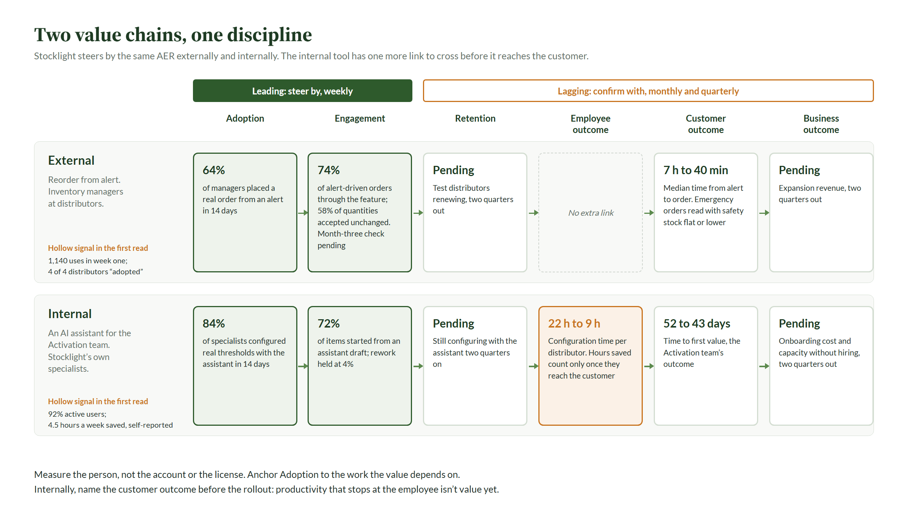

# Adoption, Engagement, Retention: The Behaviors That Show Value Before Results Do

Six weeks after two launches at Stocklight, two dashboards said the same thing: it worked.

Stocklight, the illustrative company this series has followed, sells inventory visibility software to regional industrial distributors. Its strategy aims at $40M in revenue from distributors by 2028 and runs through one value stream, Keep Distributors Stocked, tested first with 10 distributors. Two Core teams serve it: the Adoption team, which gets distributors acting on alerts, and the Activation team, which gets each new distributor live.

The first was for customers. A new feature, born in the Adoption team’s discovery visits, let inventory managers place a reorder straight from an alert. In its first week, it was used 1,140 times across the pilot distributors.

The second was for Stocklight’s own people. Leadership had made an AI assistant available to the implementation specialists on the Activation team, who configure each new distributor. By day 30, 92% were active users, and a survey said the assistant saved each of them 4.5 hours a week.

Neither dashboard said anything about value. A week of clicks says a feature was noticed. An active user and a self-reported hour say a tool was tried. Whether either changed what customers get, or what Stocklight earns, was months from showing up.

That gap is where most teams make their scaling decisions blind. The last article tested whether value is real, through Efficiency, Experience, and Effectiveness. This one covers the behaviors that tell you early whether value is coming: Adoption, Engagement, and Retention. It’s also about the difference between the indicators a team steers by and the ones that confirm whether it steered well.

## Three behaviors, two kinds of indicators

Value can’t be observed directly, but the behavior of the people it’s for can. Did they start? Did they make it part of their work? Did they stay, and bring others? In the system behind this series, those three questions are the [Adoption, Engagement, Retention (AER)](https://github.com/Insheights/in-frameworks/blob/master/aer.md) model:

→ **Adoption:** the stakeholder starts using what was delivered, on the work it was built for. Not a login, a license, or a click: a first real use.

→ **Engagement:** they use it again, at the depth and frequency the value needs, and rely on it instead of the old way.

→ **Retention:** they keep choosing it long after the launch attention fades, a customer by renewing, a colleague by still working that way a quarter or two on. Continued use while the value is still being realized is Engagement; choosing it beyond that is Retention. In some sectors the proof is Recommendation instead: a referral actually made, not a survey answer. What people say they’d do is Experience; AER records what they then do.

AER sits under Efficiency, Experience, Effectiveness (3E). 3E asks whether value is real for the stakeholder. AER shows whether they behave as if it is. The model expects the two to read in the same order: people adopt what they can use with less effort, engage with what they trust, and stay with, and recommend, what gets them the result they came for.

The three behaviors don’t arrive together, and that’s what makes them useful. Adoption shows up in days and Engagement in weeks. Retention, or Recommendation, takes a quarter or more, and the customer and business outcomes behind them take longer still. So AER splits into two kinds of indicators:

→ **Leading indicators, to steer by.** Adoption and Engagement. The team defines them, sets targets, reviews them weekly, and changes its work when they move. They pass two tests: they’re influenceable, shaped mostly by what the team ships, and they’re predictive, arriving early enough to act on and signaling what will follow.

→ **Lagging indicators, to confirm with.** Retention, or Recommendation where that is the sector’s proof, and the customer and business outcomes they lead to. They confirm whether value was delivered, but late, and they’re shaped by much more than one team’s work: pricing, service, a competitor, a customer’s budget. They’re reviewed on a slower cadence and used to check whether the leading indicators are the right ones.

Both kinds are measured. What differs is what each is for: one to steer by, the other to confirm the course. The split isn’t about importance either. Lagging indicators are what the strategy is for, and an empowered team still owns its outcome, as article 6 set out. But no one can steer week to week by a renewal that comes due in nine months. A team steers by its leading indicators and confirms its course with its lagging ones.

The two have to be linked. A leading indicator earns its place only if it predicts a lagging one. When Adoption and Engagement hold at target over three readings and Retention doesn’t follow, the team is measuring the wrong behavior.

Leading and lagging describe position in the chain, not a fixed type. Each link leads the next: Retention lags Engagement but leads revenue, and time to first value lags onboarding work but leads renewals. A stream owner steers by Retention and customer outcomes the way a team steers by Adoption and Engagement.

## External: a feature from continuous discovery

After the fixes in the last article, Stocklight’s inventory managers trusted their alerts: seven in ten said so at the discovery visits, and that stated trust was the Experience test. What they then did, the last article handed to this one. Most were ordering straight from an alert, and 63% were still acting on alerts in their third month. Both shares are Engagement: the behavior that shows people rely on what they trust. The Adoption team kept running its monthly discovery visits anyway, because solving one problem usually uncovers the next.

It did. Managers now ordered from alerts without checking a spreadsheet first, but the order itself still happened somewhere else. A manager read the alert in Stocklight, opened the warehouse system's purchasing screen, and re-keyed the item, supplier, and quantity. That took 4 to 6 minutes per order, and at two distributors the order then waited for a purchasing clerk. The alert arrived on time. The order didn’t.

The team framed the opportunity as the time from alert to order, and tested a solution: reorder from the alert. One action drafts a purchase order in the distributor’s warehouse system, with a suggested quantity drawn from the item’s lead time and demand. It shipped to 4 of the 10 test distributors first.

## The first read

The launch review reported what was easy to count:

> ***Uses:*** *1,140 in the first week*

> ***Distributors adopted:*** *4 of 4*

Both were true, and neither was Adoption. The 1,140 uses included managers opening a draft to see what it did, then closing it. A distributor counted as adopted when anyone there used the feature once. At one of the four, a single manager placed most of the orders while six colleagues kept re-keying.

## The second read

The team rebuilt its indicators around the behavior the value depends on: managers placing orders from alerts, when the alert arrives.

→ **Adoption (leading, weekly):** the share of managers, not distributors, who placed at least one real purchase order from an alert in their first 14 days. Target 60%.

→ **Engagement (leading, weekly):** the share of alert-driven orders placed through the feature rather than re-keyed; target 70%. The share of suggested quantities accepted without a change; target 50%. And, read monthly, the share of managers still ordering from alerts in their third month; target 60%.

Every target was a starting band, to be recalibrated against the first readings from the pilot.

→ **Retention (lagging, quarterly):** the test distributors renewing. Read alongside it, Recommendation: referrals the account team logged, managers who brought a peer at another distributor to see it.

→ **Customer outcome (lagging, monthly):** time from alert to order placed, and the team’s outcome from the last article: emergency orders down 30%, with safety stock flat or lower.

→ **Business outcome (lagging, quarterly, read by the executive team’s decision forum):** expansion revenue from the test distributors, toward the $40M revenue goal.

None of these measures was part of the strategy’s rejection condition, the test that would send the strategy’s bet back to the executive team’s decision forum. So they were the team’s to set, and it reported them at the stream owner’s next monthly review.

Engagement caught the next problem within two weeks. Adoption had reached 64%, but only 31% of suggested quantities were accepted as-is; managers were cutting most of them. Shadowing two managers showed why. The suggestion ignored already open purchase orders, so it double-counted stock in transit.

Managers were using the feature without trusting its numbers. That’s a 3E Experience failure, and Engagement is where it showed up first, long before any renewal could.

The team fixed the calculation to net out open orders. Four weeks later, 58% of suggestions were accepted unchanged, and 74% of alert-driven orders went through the feature. The median time from alert to order fell from about 7 hours to 40 minutes. The team rolled the feature out to the other six distributors.

Retention and the business outcome hadn’t confirmed anything yet, and the team didn’t claim they had. The third-month Engagement check was on the calendar, and the renewal cycle was two quarters out. What it had was two leading indicators moving for the right reason, and a prediction that could fail: if Engagement held at target through the third-month check and the test distributors still didn’t renew, the leading set was wrong.

## Internal: an AI assistant for the people who serve customers

The second launch looked inward, and it started with a side effect of the last article. Setting thresholds for each item from its lead time and demand variability cured alert fatigue. It also meant someone had to configure thousands of item-level thresholds for every new distributor. The Activation team’s time to first value sat at 52 days against a 30-day target, and most of the gap was configuration.

Stocklight made the AI assistant available to the Activation team’s 25 implementation specialists, the people who do that configuration. The intent was productivity. Inside a company, though, productivity isn’t the end of the chain. It’s the first of three links: the employee’s work gets better, which improves what customers get, which shows up in what the business earns.

## The first read

At day 30, the rollout report said:

> ***Active users:*** *92%*

> ***Prompts:*** *31 per user per week*

> ***Time saved:*** *4.5 hours per person per week, self-reported*

Time to first value hadn’t moved. Neither had the cost to onboard a distributor, and the onboarding queue was still three weeks deep.

Shadowing a week of the team’s work explained it. Specialists used the assistant for email, meeting recaps, and status notes. The work that set time to first value, cleaning a distributor’s item data and setting thresholds, still happened by hand in spreadsheets. The assistant couldn’t see item history, and the two specialists who tried pasting data in found its threshold math unreliable.

The 4.5 hours were probably real. But they spread those hours across tasks that didn’t gate onboarding, and nobody redeployed them. “Hours saved” is the internal version of “acted on” from the last article: it moves easily, it feels like value, and it can’t tell you whether anyone outside the building is better off.

## The second read

The rollout was handed to a small internal product team: two implementation leads and an IT engineer. They treated the assistant as a product with its own value stream and named its stakeholders in order: implementation specialists, then distributors, then Stocklight. Then they named the one workflow where productivity would reach customers, configuring item-level thresholds during onboarding. They connected the assistant to the distributor’s item history and gave it a reviewed method for computing thresholds.

→ **Adoption (leading, weekly):** the share of specialists who configured a real distributor’s thresholds with the assistant within 14 days of the connection going live. Target 80%.

→ **Engagement (leading, weekly):** the share of items configured from an assistant draft; target 70%. And the rework rate: thresholds changed within 30 days of go-live because they fired false alarms; target under 5%.

Again, every target was a starting band, recalibrated after the first readings.

→ **Retention (lagging, quarterly):** the share of specialists still configuring with the assistant two quarters on. Read alongside it, Recommendation: how many colleagues on the Adoption team they brought into the workflow.

→ **Employee outcome (lagging, monthly):** configuration hours per distributor.

→ **Customer outcome (lagging, monthly):** time to first value, the Activation team’s outcome.

→ **Business outcome (lagging, quarterly, read by the executive team’s decision forum):** onboarding cost per distributor, and how many distributors the team can onboard each quarter without adding headcount.

The rework rate mattered most. A fast threshold that fires false alarms would rebuild the alert fatigue the Adoption team had just removed. That’s one team’s productivity paid for with another team’s customer outcome.

Eight weeks later, 84% of specialists were configuring with the assistant and 72% of items started from its draft. Rework held at 4%. Configuration time fell from about 22 hours per distributor to 9, and the queue cleared. Time to first value moved from 52 days to 43, the first time it had moved for a reason the team could trace.

The business outcome was still unconfirmed, and the team didn’t claim it. Whether cheaper onboarding would let Stocklight grow past its 10 test distributors without hiring would show over the next two quarters. The team could say the chain held at every link it could see so far. The first read had a large number at the first link and nothing after it.

## Two chains, one discipline

Both launches ran on the same AER. The internal chain has one more link, and that link is where most internal tools lose their value.

Three lessons carry across both.

**Measure the person, not the account or the license.** Externally, an adopted distributor hid six managers still re-keying orders. Internally, an active user hid a tool used for everything except the work that mattered.

**Anchor Adoption to the work the value depends on.** Both first reads counted contact with something new. Both second reads counted the behavior the outcome needs.

**Internally, name the customer outcome before the rollout.** An external feature starts with a customer, so the chain to customer outcomes exists from day one. An internal tool starts with a workforce, and productivity can stop at the employee: absorbed, spent on low-value work, or never redeployed. A team that can’t name the customer outcome its productivity should move has a tool, not a value stream.

The cadence follows the chain. The team steers by Adoption and Engagement weekly and changes its work as it moves. The stream owner reviews customer outcomes monthly and Retention quarterly, and steers by them across teams. The executive team’s decision forum confirms with business outcomes quarterly, and asks whether the indicators below it still predict what it sees.

## What the evidence says

Researchers in product analytics, customer loyalty, information systems, and AI at work have each found part of this.

**Product teams already measure in behaviors.** Google’s HEART framework (Kerry Rodden, Hilary Hutchinson, and Xin Fu, CHI 2010) measures user experience at scale through Happiness, Engagement, Adoption, Retention, and Task success. AER uses three of its five. HEART also ties every goal to a signal and a metric, the same discipline that turns “used it once” into “placed a real order.” AER differs in sitting under 3E and in splitting its behaviors into what a team steers by and what confirms the course.

**Recommendation predicts, but not alone.** In “The One Number You Need to Grow” (Harvard Business Review, 2003), Fred Reichheld argued that a customer’s willingness to recommend was the best single predictor of growth. Timothy Keiningham and colleagues, in the Journal of Marketing (2007), couldn’t replicate its claimed superiority over other measures. And willingness is still a stated intent. AER counts the referral itself, as one lagging indicator among several, used to confirm rather than steer.

**Internally, people use what’s useful to them.** Fred Davis’s Technology Acceptance Model (MIS Quarterly, 1989) found that people use workplace systems when they believe them useful and easy to use, with usefulness the stronger driver. Stocklight’s specialists didn’t reject the assistant. They used it where it was useful to them, which wasn’t where it was useful to customers, until the team connected it to the work that was.

**AI productivity can reach customers.** In [a study of 5,179 customer support agents](https://www.nber.org/papers/w31161), Erik Brynjolfsson, Danielle Li, and Lindsey Raymond found an AI assistant raised issues resolved per hour by 14% on average, and 34% for novice and low-skilled agents. It also improved customer sentiment and employee retention. That’s a full chain from employee to customer, and it happened because the tool sat inside the core work.

**It can also quietly make work worse.** In a [field experiment with 758 BCG consultants](https://ssrn.com/abstract=4573321), Fabrizio Dell’Acqua and colleagues found that on tasks within AI’s capabilities, consultants with AI completed 12.2% more tasks, 25.1% faster, at more than 40% higher quality. On a task chosen to sit just outside what AI could do well, they were 19 percentage points less likely to reach a correct answer. That’s why Stocklight’s Engagement included a rework rate: usage alone can’t tell good reliance from bad.

## Writing your own

**Template 8: the AER indicator set.** This sits beside the 3E outcome profile from the last article. The profile names the three tests an outcome has to pass. This set names the behaviors that show early whether it will.

> *For **[what was delivered]**, **[stakeholder]** adopt it when **[the first real use, on the work it was built for]** within **[days]**, target **[share]**; they engage when **[the behavior the value depends on]** reaches **[depth or frequency]**, target **[share]**; and they stay when **[the choice that confirms it: renewal, use beyond the point the value should show, or, by sector, a referral made]** by **[date]**. We steer by Adoption and Engagement every **[cadence]**, and confirm with Retention every **[cadence]** and with **[the customer or business outcome they should predict]** every **[cadence]**.*

Stocklight’s Adoption team:

> *For reorder from an alert, inventory managers adopt it when they place a real purchase order from an alert within 14 days, target 60%; they engage when 70% of alert-driven orders go through the feature, 50% of suggested quantities are accepted unchanged, and 60% are still ordering from alerts in their third month; and they stay when the test distributors renew by the end of Q4 2027. We steer by Adoption and Engagement weekly, and confirm with renewals quarterly and, monthly, with time from alert to order and emergency orders falling 30% with safety stock flat or lower.*

If you can’t name the customer or business outcome your Adoption and Engagement should predict, you have activity, not indicators. In the Insheights Integrated Value Creation System (IIVCS), the [AER model](https://github.com/Insheights/in-frameworks/blob/master/aer.md) defines the three behaviors and their two tracks. Both cases here are on the customer track, since the AI assistant’s customers were Stocklight’s own specialists; the organizational track reads whether teams take up the operating model itself. The [metrics and indicators guide](https://github.com/Insheights/in-frameworks/blob/master/metrics-and-indicators.md#part-2--aer-metrics-and-indicators) gives candidate signals for each.

## What comes next

AER tells you what people do. The next article, “Let Customer Behavior Write Your Next Hypothesis”, shows how to turn what they do into a team’s next hypothesis, long before a renewal tells you.

The frameworks behind this series are open on GitHub: [github.com/Insheights/in-frameworks](https://github.com/Insheights/in-frameworks)

**Where does your organization stand?** The [Quick Self-Assessment](https://github.com/Insheights/in-frameworks/blob/master/quick-assessment.md) gives a directional reading in a few minutes: eight questions on how well strategy, teams, delivery and measurement work together.

*Think of the last tool your organization rolled out. Could you name the customer outcome it was meant to move, or only how many people use it?*
