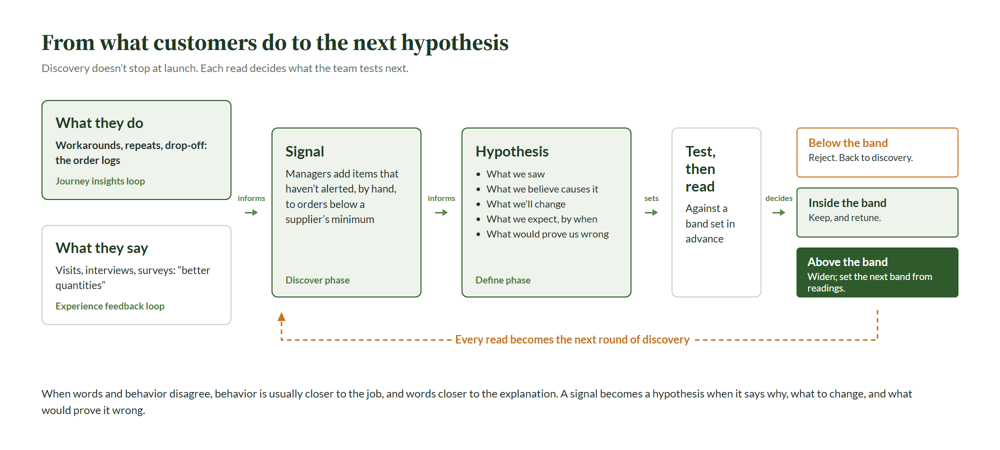
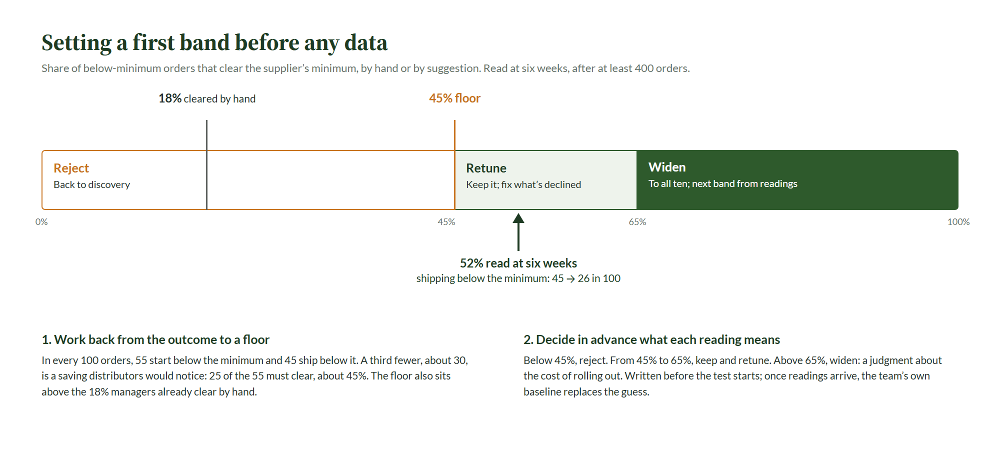

# Let Customer Behavior Write Your Next Hypothesis

*What people do shows the next problem before they name it.*

Stocklight’s third-month check came in on target. Of the inventory managers using reorder from an alert, 66% were still ordering from alerts in their third month. The team had aimed for 60%. The early signal it steers by had held.

The order logs also showed something nobody had asked about. Managers were adding items that hadn’t alerted to their orders, by hand.

No manager had mentioned it at a discovery visit. Asked what they wanted next, most said better suggested quantities. Their orders said something else.

This article is about that gap: how a team turns what customers do into its next hypothesis, sets a target for a behavior it has never measured, and decides in advance what each reading will mean.

## The story so far

Stocklight, the illustrative company this series follows, sells inventory visibility software to regional industrial distributors. Its strategy runs through one value stream, Keep Distributors Stocked, tested with 10 distributors. The Adoption team owns getting distributors to act on alerts.

[Article 7](https://medium.com/@xambrose/efficiency-experience-effectiveness-the-three-tests-of-real-value-d60780d197eb) made the alerts trustworthy. [Article 8](https://medium.com/@xambrose/adoption-engagement-retention-the-behaviors-that-show-value-before-results-do-e7ba8388ce92) launched reorder from an alert, which drafts a purchase order straight from the alert, and measured it through Adoption, Engagement, Retention (AER): the team steers by Adoption and Engagement, the leading indicators, while Retention and renewals confirm it later.

## A signal is not yet a hypothesis

Most teams collect signals. Fewer turn them into something they can test. “Managers add items by hand” is an observation. It doesn’t say why, what to change, or what would show the change was wrong.

A hypothesis does. It has five parts:

→ **What we saw.** A behavior, in whose actions, how often.

→ **What we believe causes it.** One explanation, stated so it could be false.

→ **What we’ll change.** The smallest change that would test the belief.

→ **What we expect.** A leading indicator, a target, and a date, with the lagging indicator that should follow.

→ **What would prove us wrong.** The result, decided before the test starts, that sends the team back to discovery.

In the Insheights Integrated Value Creation System (IIVCS), this is [continuous discovery](https://github.com/Insheights/in-frameworks/blob/master/glossary.md#core-system-and-frameworks), one of the five Product Mindset principles, joined to a second, hypothesis-driven thinking. Discovery doesn’t stop at launch. The launch is where the next round of it starts.

## Words and behavior

The Customer Value Delivery Model (CVDM) has two [feedback loops](https://github.com/Insheights/in-frameworks/blob/master/feedback.md#operational-feedback--cvdm) that read the customer first, and they read in different ways. Experience feedback reads their words: interviews, in-product surveys, the monthly discovery visits. Journey insights reads their behavior: where they drop off, what they repeat, what they work around. The Adoption team owns both, and reads the order logs weekly.

Both matter, and they answer different questions. Words tell a team how something feels and what people think they need. Behavior tells it what they actually do when the work is in front of them. When the two disagree, behavior is usually closer to the job, and words are usually closer to the explanation.

That was Stocklight’s case. The request for better quantities was real, and the team logged it. But the workaround was in the order data, repeated thousands of times, by managers who never thought to mention it because, to them, it was just how ordering works.

So the team went back to the managers with the behavior, not a question about features. It showed three managers their own orders and asked why those lines were there. All three gave the same answer. Their main suppliers waive freight above an order minimum. When an alert fires and the order falls short, managers top it up with items that will run low soon, so it clears the minimum and ships free. When they don’t, they pay freight or hold the order until it clears.

Two minutes of looking up nearly-due items per order, every time. And it was invisible in every survey.

## The hypothesis

The team counted on one base: alert-driven orders to suppliers with a freight minimum. In every 100, 55 started below the minimum when the alert drafted them. Managers topped up 10 of those 55 by hand, 18%, so 45 shipped below it.

Then it wrote a value hypothesis, the form the Define phase of the [Product Transformation System (PTS) lifecycle](https://github.com/Insheights/in-frameworks/blob/master/guides/pts-practitioners-guide.md#step-4--run-the-continuous-product-lifecycle) gives it, before building anything:

> *We saw managers top up 18% of below-minimum orders by hand with items that hadn’t alerted. We believe they’re clearing the supplier’s freight minimum. If reorder from an alert suggests the nearly-due items that would clear it, we expect at least 45% of below-minimum orders to clear the minimum, by hand or by suggestion, at four distributors by the six-week read. Orders shipping below the minimum should then fall from 45 in 100 toward 30, with safety stock flat. We’ll reject this if fewer than 45% clear by the six-week read, or if safety stock rises by more than two days of cover.*

The last clause matters as much as the first. Topping up orders could hide a cost: if suggestions pull stock forward too early, freight falls and inventory rises. The team tested for the outcome its customers care about, not only the behavior it hoped to see.

Two indicators carried the test. Engagement, leading and read weekly, was the share of below-minimum orders that cleared the minimum. It counted hand top-ups too, so the feature got no credit for what managers already did. The customer outcome, lagging and read monthly, was orders shipping below the minimum, with safety stock read alongside. Neither measure appeared in the strategy’s rejection condition, so both were the team’s to set, and it reported them at the next reconciliation read, the monthly management review where leading signals are read.

## Setting the first band before any data

Article 8 said every target was a starting band, to be recalibrated against the first readings. A reader asked a fair question: where does the first number come from, when there are no readings yet?

Stocklight had no readings for this. No one had ever been offered a top-up. The team set its band in two steps.

**First, work back from the outcome to a floor.** The account team’s view was that distributors would notice the saving if orders shipping below the minimum fell from 45 in 100 to about 30, a third fewer. Getting there meant 25 of the 55 below-minimum orders clearing the minimum instead of 10: about 45%. That was the floor. Below it, the feature couldn’t move the outcome enough to matter, however much it was used.

The floor also had to sit above what people already do. Managers already cleared 18% by hand. A target near that would only show the feature replacing work people did unprompted. At 45%, it sat well above.

**Second, decide in advance what each reading means.** Before the test began, the team wrote down three readings and what each would trigger. A reading would count only after at least 400 below-minimum orders, so a quiet week couldn’t decide it.

→ **Below 45% at six weeks:** reject the hypothesis. Go back to the visits: the belief, or the way the suggestion works, is wrong.

→ **45% to 65%:** keep it, and retune. Look at which suggestions managers turn down and why.

→ **Above 65%:** widen to the other six distributors, and set the next band from the team’s own readings.

The floor came from the outcome. The upper line was a judgment: rolling out to six more distributors costs onboarding and support time, so the team wanted a clear margin before paying it.

A first band isn’t a forecast. It’s the smallest result that would be worth having, worked back from the outcome, set above what people already do, with each reading’s consequence agreed before anyone sees the number. Once real readings arrive, the team’s own baseline replaces the guess. The IIVCS [metrics guide](https://github.com/Insheights/in-frameworks/blob/master/metrics-and-indicators.md) treats every threshold the same way: baseline-relative, or a conservative starting band to calibrate.

At six weeks, across 610 below-minimum orders, 52% cleared the minimum, and orders shipping below it had fallen from 45 in 100 to 26. Safety stock was flat. Inside the band: the team kept the feature and retuned it, starting with the suggestions managers declined most, items with uncertain demand.

## Whose hypothesis is it?

This one was the team’s. It sat inside the team’s own measures, so the team set it, tested it, and reported it.

The visits also turned up something the team couldn’t settle alone. Freight terms shaped how distributors ordered more than anyone had assumed, and the strategy’s growth case rested on more managers ordering through Stocklight, not on suppliers. If supplier terms were part of the value, that might call for a new strategic hypothesis. That wasn’t the team’s to decide. It returned the signal, through its Strategic signals loop, to the executive team’s [decision forum](https://github.com/Insheights/in-frameworks/blob/master/glossary.md#key-concepts), which gives each strategic hypothesis its status before it decides on priorities. How that loop works is the next article.

## What the evidence says

Discovery as a continuous practice is general product practice, and several researchers have shaped how it’s done.

**Continuous means weekly, by the team.** In *Continuous Discovery Habits* (2021), Teresa Torres defines continuous discovery as, at a minimum, weekly touchpoints with customers by the team building the product, in pursuit of a desired outcome. IIVCS shares the team’s ownership: the team owns its loops. It runs each loop at its own cadence, as Stocklight reads behavior weekly and visits monthly, and reads what they find through AER.

**Watch what people do.** In “First Rule of Usability? Don’t Listen to Users” (2001), Jakob Nielsen argued that to design well you watch what users do, not believe what they say they do. Stocklight’s workaround never appeared in what managers said.

**Decide what counts before the test.** Eric Ries, in *The Lean Startup* (2011), built the cycle of build, measure, and learn around validated learning: setting up an experiment so its result can change what the team does next. Writing each reading’s consequence before the test is that idea in practice.

**Most ideas don’t work.** Ron Kohavi and colleagues reported in 2009, from Microsoft’s online experiments, that only about a third of the ideas tested improved the metric they were designed to improve. A team that writes a rejection condition expects to use it.

## Writing your own

**Template 9: the behavior-led hypothesis.** This follows the AER indicator set from the last article. The set names the behaviors that show value is coming. This turns a behavior nobody planned for into the next thing to test.

> *We saw **[behavior]** in **[whose actions]**, **[how often, on a stated base]**. We believe **[the cause]**. If we **[the smallest change that tests it]**, we expect **[leading indicator, on the same base]** to reach **[starting band]** by **[date]**, and **[lagging indicator]** to follow by **[date]**. We’ll reject this if **[observable result]** by **[date]**. The band is worked back from **[the outcome floor]** and sits above **[what people already do unprompted]**. Below it we **[go back to discovery]**; inside it we **[retune]**; above it we **[widen]**.*

Stocklight’s Adoption team:

> *We saw managers top up 18% of below-minimum orders by hand with items that hadn’t alerted. We believe they’re clearing the supplier’s freight minimum. If reorder from an alert suggests the nearly-due items that would clear it, we expect at least 45% of below-minimum orders to clear it at four distributors by the six-week read, and orders shipping below the minimum to fall from 45 in 100 toward 30 by the next quarter, with safety stock flat. We’ll reject this if fewer than 45% clear by the six-week read, or if safety stock rises by more than two days of cover. The band is worked back from a third fewer orders shipping below the minimum and sits above the 18% cleared by hand. Below it we go back to the visits; inside it we retune; above 65% we widen to all ten.*

## Test your own

Pick one thing your customers do that no one designed for: a workaround, an export, a step done outside your product. Can you say what you believe causes it? Could you name the smallest change that would test that belief, and the result that would make you drop it?

## What comes next

This hypothesis stayed with the team. The next one didn’t: a signal that bore on the strategy itself. The next article, “How Delivery Should Rewrite Strategy”, follows what happens when what customers do reaches the forum that decides the strategy.

The frameworks behind this series are open on GitHub: [github.com/Insheights/in-frameworks](https://github.com/Insheights/in-frameworks)

**Where does your organization stand?** The [Quick Self-Assessment](https://github.com/Insheights/in-frameworks/blob/master/quick-assessment.md) gives a directional reading in a few minutes: eight questions on how well strategy, teams, delivery and measurement work together.

*When did your team last change its plan because of something customers did, not something they said?*
