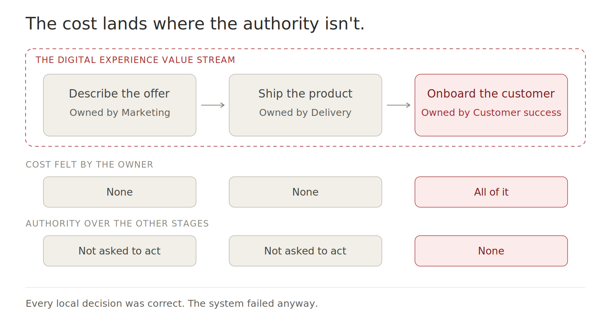

# Your Enterprise AI is paced by processes no one revisits.

Most enterprise leaders now believe the hard part of AI is acquiring capability. Pick the right platform, staff a capable team, and put governance in place. After that, it’s execution.

That belief is the problem, and nowhere more than internally, where AI runs on processes nobody has revisited in years.

A SaaS company deployed AI across its digital experience, from lead through to customer. The customer-facing side had everything: investment, attention, ownership. The internal processes underneath were the substrate everything ran on, and they were treated as settled.

What marketing described, what customers needed, and what delivery shipped had all moved independently. Nothing reconciled them. The AI sat on top, confidently generating an experience from records nobody was measured on keeping current.

Customers found errors and reported them to customer success. The company added a verification step to the onboarding SOP: a champion would check every delivery for correctness before it reached the customer.

Now look for who did anything wrong. Marketing described what it was told. Delivery shipped what existed. Customer success caught the difference and escalated it. Adding the check was cheap and fast, and it prevented customers from seeing errors. Every decision was correct inside the boundary where it was made.

But the system failed anyway. Clean onboarding took under a day. Onboarding with discrepancies took one to two weeks. Two weeks of a new customer waiting, at the exact moment they are deciding whether this was a good decision. That variance sat in an operations metric for months while its cause sat three teams away.

You cannot outrun what you are running on. Add capability on top of a stale stream, and you get faster wrongness, not faster value.

This is a systems failure, not a performance failure, which is what makes it hard to fix rather than hard to see. There was no bad actor to correct and no incompetence to address. The failure lived in the space between functions, which is precisely the space no function can reach. The cost landed entirely on customer success, so marketing and delivery felt nothing and had no reason to spend effort on someone else’s problem. The one function carrying the pain had the least authority to convene the two causing it. Silos are the shape of that. The gap between where cost lands and who can act is the mechanism.

*The stages have owners. The stream does not. The function carrying the cost had the least authority to fix it.*

Seeing that much is diagnosis. It tells you the failure is in the whole, not the parts. It doesn’t tell you how to operate differently, and that is the harder question, because the answer can’t be a better org chart. It has to be a way of working that holds when nobody can see the whole from their own standpoint.

**This company already had that way of working. They used it exclusively on people who paid them.**

They obsessed over customer needs, and nobody thought of the champion as a customer of that process, though their week was consumed catching someone else’s errors.

They ran continuous discovery on the product. SOPs were written as needed and never revisited.

They treated product bets as hypotheses to be tested, and treated “a verification step will fix this” as a conclusion.

They measured outcomes for buyers, and measured onboarding by completion. Worse, the check made the real number disappear: once verification lives in the runbook, the error rate ceases to be a metric and becomes a task. A person absorbs it before it can surface anywhere it would be counted.

They drew ownership around the whole customer journey and left the internal stream owned at the segment level.

Customer obsession, continuous discovery, hypothesis-driven thinking, outcome over output, cross-functional ownership. Those five are the product mindset, and this company practiced all of them rigorously, just not past the revenue line.

That asymmetry was survivable while people executed the process because they noticed when a step no longer made sense. It stops being survivable once you automate it. Encoding a process doesn’t make it correct. It makes it faster, more consistent, and considerably harder to question.

The fix required mapping the digital experience value stream end-to-end, which no single function could do from within its own boundary. Once the drift between systems was addressed, onboarding went from one to two weeks to minutes. The verification step didn’t disappear. It became automated and optional. The check stayed; the champion doing it went back to their actual job.

**Which of your internal processes is your Enterprise AI running on right now, and who has both the pain and the authority to fix it?**
