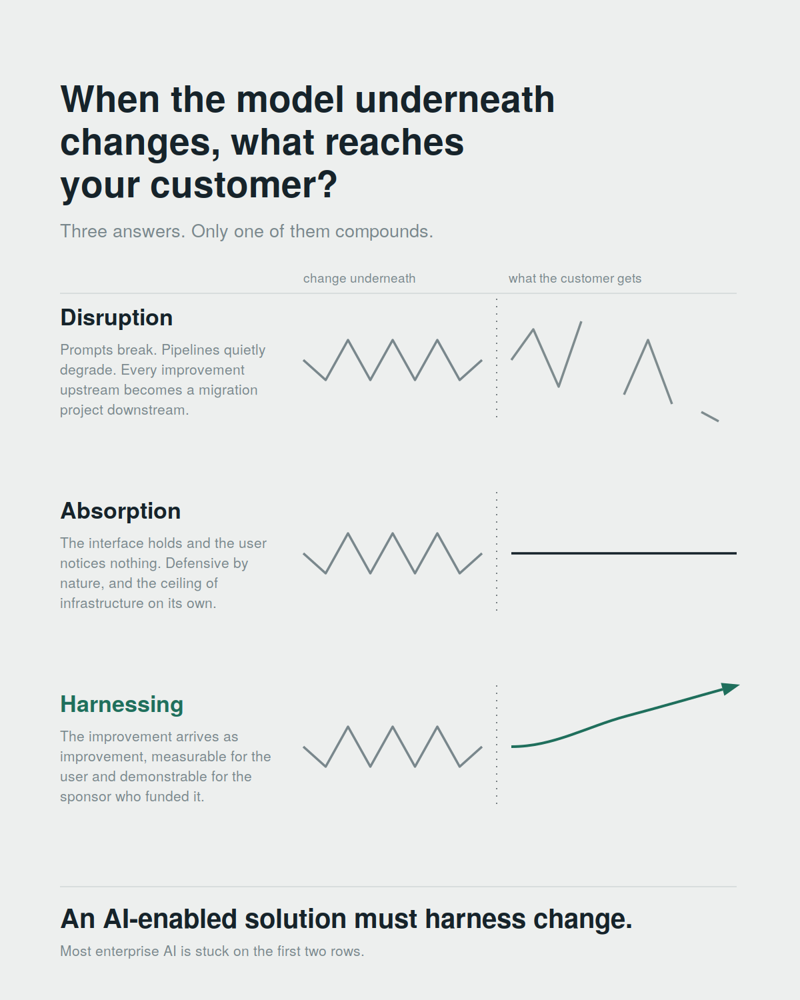

# AI-enabled solutions are products

Everything underneath an enterprise AI system is in motion. Models are replaced on a cadence measured in months. Context windows, pricing, latency, and tool-calling behavior move with them. Data schemas drift. Source systems get migrated, consolidated, or acquired. Processes get redesigned around the very capability you just deployed. Regulation arrives.

None of that is exceptional. It is the permanent condition.

So the useful question about any AI investment is not whether it works today. It is what happens to your customer when the layer underneath it changes. There are only three answers. The change reaches them as **disruption**, which is where most assembled capability lives. Or it is **absorbed**, and they notice nothing. Or it is **harnessed**, and the improvement underneath arrives as improvement they can see.

Absorption is a shock absorber. Harnessing is a transmission. That distinction is the whole game, and it's why an AI-enabled solution has to be a product.

## Capability is not a solution

Start with what most enterprises actually have.

MCP is integration for AI. It is not AI. Vector databases are storage for AI. Orchestration frameworks are control flow. Evaluation harnesses are testing. Guardrail layers are policy enforcement. All of it is necessary, and almost none of it is what an organization means when it says it wants an AI solution.

This is not a criticism of infrastructure. Infrastructure is how an industry stops rebuilding the same adapter forty times. But a category error runs through most enterprise AI programs, and it is expensive: teams assemble infrastructure, demonstrate capability, and then discover they have built nothing anyone can be held accountable for.

A product has four things that assembled capability does not.

It has a **named user**. Not “the business.” A person whose day changes.

It owns a **job**. Something that was previously someone’s problem and is now the product’s problem.

It has a **boundary**. A clear statement of what is inside and what is not, and what it will not do.

It has **accountability**. When it fails, a party owns the failure, and everyone shares a definition of what failure means.

Most stalled AI programs fail the last two. They have capability without a boundary, so every stakeholder holds a private mental model of what was promised, and nobody owns the distance between them.

## Why only a product can harness change

Return to the three answers, and notice what each one requires.

Disruption requires nothing. It is the default. Build tightly against the specifics of a moment and the moment will move.

Absorption requires an abstraction. A well-chosen interface holds while things churn behind it. This is a genuine achievement, and it is also infrastructure's ceiling, because absorption is defensive by nature. Nothing got worse.

Harnessing requires something infrastructure cannot supply: intent. Someone has to decide what a better model underneath *should* buy the user, then do the work of converting the one into the other, then show that it happened. That decision has an owner, a beneficiary, and a standard of success. Those are product properties. A protocol has no opinion about them, and it shouldn’t.

That is the precise sense in which an AI-enabled solution must be a product. Not because products are how you charge. Because a product is the only structure that can hold an intention across change.

## Harnessing is a commitment, not a claim

Absorption happens on its own once an abstraction is well chosen. Harnessing never happens on its own. You adopt it on purpose, ahead of the change: you decide in advance what a better model underneath should buy the user, and you build the product so improvement has somewhere to go.

That commitment is what produces the evidence. A baseline, a way to attribute improvement to the change rather than to everything else that moved, a surface the sponsor actually reads — none of that is proof assembled afterward to satisfy a skeptic. It is what a declared intention looks like once it reaches an architecture. A team that never declared one has nothing to show, not because it failed a test but because it was never aiming at anything.

And since intent has an owner, the sponsor’s question is who holds it: the product by design, the vendor on the customer’s behalf, or the customer steering explicitly. Settled up front, that is governance. Left to emerge, it is drift with good intentions.

## Three questions

At the next AI investment review, skip the demo and ask these.

Who is the named user, and what job does this own on their behalf?

When the model underneath changes next quarter, does that reach them as disruption, as nothing, or as benefit?

If the answer is benefit: who decided, and show me the measurement.

Most programs cannot answer the first. Nearly all fail the third. That gap, not model quality, is where enterprise AI value is being lost right now.
